nipin# 小程序排课与体测管理系统｜功能模块设计文档（FDD）

## 1. 文档信息

| 项目 | 内容 |
|---|---|
| 系统名称 | 小程序排课与体测管理系统 |
| 文档名称 | 功能模块设计文档（Functional Design Document，FDD） |
| 文档版本 | V1.0 |
| 适用阶段 | 产品评审、研发实现、测试设计、验收交付 |
| 关联文档 | 产品需求文档、系统架构文档、系统设计文档 SDD、数据库设计文档 |
| 目标终端 | PC 管理后台、教师微信小程序、家长微信小程序 |
| 角色 | 管理员、教师、家长 |
| 编写日期 | 2026-07-23 |

---

# 2. 文档目的

本文档从业务和用户操作视角，对系统各功能模块进行详细设计。

本文档主要回答以下问题：

1. 每个模块为谁提供服务；
2. 用户从哪里进入功能；
3. 功能需要展示哪些信息；
4. 用户可以执行哪些操作；
5. 操作前需要满足什么条件；
6. 正常流程如何执行；
7. 异常场景如何提示和处理；
8. 数据状态如何变化；
9. 不同角色拥有哪些权限；
10. 每项功能如何验收。

本文档不展开底层技术实现、类设计和数据库 SQL，相关内容以 SDD 和数据库设计文档为准。

---

# 3. 系统范围

## 3.1 系统角色

### 3.1.1 管理员

管理员主要使用 PC 管理后台。

管理员具有以下权限：

- 教师、家长和学员账号管理；
- 家长与学员绑定；
- 课程管理；
- 班级管理；
- 排课、调课和取消课程；
- 课程签到和完成；
- 课时充值、扣减、补录和调整；
- 体测模板配置；
- 体测数据管理；
- 体测报告生成和作废；
- Excel 导入导出；
- 全部操作日志查询。

### 3.1.2 教师

教师主要使用微信小程序。

教师与管理员在以下模块拥有一致业务权限：

- 学员业务信息维护；
- 课程管理；
- 班级管理；
- 排课管理；
- 课程签到和完成；
- 课时充值和调整；
- 体测模板管理；
- 体测数据录入和修改；
- 体测报告生成和作废；
- Excel 导入导出。

教师不具备：

- 管理员账号管理权限；
- 全局用户权限配置能力；
- 查询其他用户完整操作日志的权限。

### 3.1.3 家长

家长使用微信小程序。

家长只能查看绑定孩子的数据：

- 孩子课表；
- 课程详情；
- 签到和完成状态；
- 剩余课时；
- 课时流水；
- 历史上课记录；
- 体测数据；
- 体测报告。

家长不能修改业务数据。

---

## 3.2 V1 功能范围

V1 包含以下模块：

1. 登录与身份认证；
2. 用户与账号管理；
3. 学员管理；
4. 家长与学员绑定；
5. 课程管理；
6. 班级管理；
7. 排课管理；
8. 上课签到与完成；
9. 课时账户与流水；
10. 体测模板；
11. 体测批次与数据录入；
12. 体测评级；
13. 体测报告；
14. Excel 导入；
15. Excel 导出；
16. 家长端查询；
17. 文件管理；
18. 操作日志。

V1 暂不包含：

- 多机构；
- 多校区；
- 在线支付；
- 订单和财务；
- 教师工资；
- 教室资源排期；
- AI 训练建议；
- 智能排课；
- 审批流程。

---

# 4. 总体功能结构

```mermaid
flowchart TB
    A["系统功能"]

    A --> B["账号与基础资料"]
    A --> C["课程与教学"]
    A --> D["课时管理"]
    A --> E["体测与报告"]
    A --> F["批量数据处理"]
    A --> G["家长服务"]
    A --> H["系统审计"]

    B --> B1["登录认证"]
    B --> B2["教师管理"]
    B --> B3["家长管理"]
    B --> B4["学员管理"]
    B --> B5["家长学员绑定"]

    C --> C1["课程管理"]
    C --> C2["班级管理"]
    C --> C3["单次排课"]
    C --> C4["周期排课"]
    C --> C5["调课与取消"]
    C --> C6["签到与完成"]

    D --> D1["课时充值"]
    D --> D2["上课扣课"]
    D --> D3["手工调整"]
    D --> D4["课时流水"]
    D --> D5["撤销扣课"]

    E --> E1["体测模板"]
    E --> E2["评级标准"]
    E --> E3["体测批次"]
    E --> E4["体测录入"]
    E --> E5["自动评级"]
    E --> E6["报告生成"]

    F --> F1["Excel导入"]
    F --> F2["Excel导出"]

    G --> G1["孩子切换"]
    G --> G2["课表查看"]
    G --> G3["课时查看"]
    G --> G4["上课记录"]
    G --> G5["报告查看"]

    H --> H1["操作日志"]
    H --> H2["文件记录"]
```



---

# 5. 功能编号规则

功能编号采用：

```text
模块缩写-三级编号
```

示例：

```text
AUTH-001 管理员登录
STU-003 修改学员
SCH-005 修改本次及以后课程
HOUR-004 手工调整课时
PHY-006 提交体测记录
```

模块缩写：

| 缩写 | 模块 |
|---|---|
| AUTH | 登录与认证 |
| USER | 用户账号 |
| STU | 学员 |
| BIND | 家长绑定 |
| COURSE | 课程 |
| CLASS | 班级 |
| SCH | 排课 |
| LESSON | 上课执行 |
| HOUR | 课时 |
| PTPL | 体测模板 |
| PHY | 体测数据 |
| REPORT | 报告 |
| IMPORT | 导入 |
| EXPORT | 导出 |
| PARENT | 家长端 |
| FILE | 文件 |
| AUDIT | 操作日志 |

---

# 6. 登录与认证模块

## 6.1 模块目标

为管理员、教师和家长提供安全登录、身份识别和会话管理能力。

---

## 6.2 使用角色

| 角色 | 登录方式 |
|---|---|
| 管理员 | 用户名和密码 |
| 教师 | 微信小程序登录 |
| 家长 | 微信小程序登录 |

---

## 6.3 AUTH-001 管理员登录

### 页面入口

```text
PC 管理后台 → 登录页
```

### 前置条件

- 管理员账号已创建；
- 账号状态为启用；
- 用户已设置密码。

### 页面字段

| 字段 | 必填 | 说明 |
|---|---:|---|
| 用户名 | 是 | 管理员登录名 |
| 密码 | 是 | 密码输入框 |
| 记住登录状态 | 否 | 可选 |
| 登录按钮 | - | 提交登录 |

### 正常流程

1. 管理员输入用户名和密码；
2. 点击“登录”；
3. 系统校验账号是否存在；
4. 系统校验账号状态；
5. 系统校验密码；
6. 登录成功后进入管理后台首页；
7. 系统记录最后登录时间。

### 异常流程

| 场景 | 处理 |
|---|---|
| 用户名为空 | 提示“请输入用户名” |
| 密码为空 | 提示“请输入密码” |
| 用户名不存在 | 提示“用户名或密码错误” |
| 密码错误 | 提示“用户名或密码错误” |
| 账号禁用 | 提示“账号已被禁用” |
| 连续失败次数过多 | 临时锁定并提示稍后重试 |
| 网络异常 | 提示“网络异常，请稍后重试” |

### 业务规则

- 不向前端区分“账号不存在”和“密码错误”；
- 密码不得明文传输和保存；
- 登录成功后生成访问凭证；
- 退出登录后当前会话失效。

### 验收标准

- 正确账号密码可以登录；
- 错误密码不能登录；
- 禁用账号不能登录；
- 登录失败次数超过限制后触发临时锁定；
- 登录成功后进入正确首页。

---

## 6.4 AUTH-002 教师微信登录

### 页面入口

```text
教师小程序 → 启动页 / 登录页
```

### 正常流程

1. 教师打开小程序；
2. 小程序获取微信临时登录凭证；
3. 系统查询微信身份是否已绑定教师账号；
4. 已绑定则直接登录；
5. 未绑定则进入手机号绑定流程；
6. 登录成功后进入教师首页。

### 异常流程

| 场景 | 处理 |
|---|---|
| 微信授权失败 | 提示重新授权 |
| 未找到教师账号 | 提示联系管理员创建账号 |
| 教师账号禁用 | 提示账号已停用 |
| 手机号与账号不匹配 | 提示无法绑定 |

### 验收标准

- 已绑定微信的教师可直接登录；
- 未绑定教师进入绑定流程；
- 禁用教师无法登录；
- 登录后展示教师端菜单。

---

## 6.5 AUTH-003 家长微信登录

### 页面入口

```text
家长小程序 → 启动页 / 登录页
```

### 正常流程

1. 家长打开小程序；
2. 系统获取微信身份；
3. 查询微信身份对应家长账号；
4. 已绑定则进入家长首页；
5. 未绑定则验证手机号；
6. 系统查询手机号对应的待确认绑定关系；
7. 家长确认孩子；
8. 完成绑定并登录。

### 异常流程

| 场景 | 处理 |
|---|---|
| 未找到待绑定孩子 | 提示联系机构录入手机号 |
| 同手机号有多个孩子 | 展示孩子列表供确认 |
| 绑定关系已解除 | 不展示该孩子 |
| 家长账号禁用 | 提示账号已停用 |

### 验收标准

- 家长可以通过手机号找到待绑定孩子；
- 一个家长可以绑定多个孩子；
- 绑定后只能看到已确认绑定的孩子；
- 已解除绑定的孩子不再展示。

---

## 6.6 AUTH-004 退出登录

### 功能说明

管理员、教师和家长均可退出当前登录状态。

### 规则

- 退出后当前访问凭证立即失效；
- 再次进入受保护页面时必须重新登录；
- 退出登录不删除微信绑定关系。

### 验收标准

- 点击退出后返回登录页；
- 原访问凭证不能继续访问业务接口。

---

# 7. 用户账号管理模块

## 7.1 模块目标

管理员维护教师和家长账号状态，确保业务人员能够正常登录系统。

---

## 7.2 USER-001 教师账号列表

### 使用角色

```text
管理员
```

### 页面入口

```text
PC 管理后台 → 用户管理 → 教师管理
```

### 展示字段

| 字段 | 说明 |
|---|---|
| 教师编号 | 机构内部编号 |
| 姓名 | 教师姓名 |
| 手机号 | 联系方式 |
| 账号状态 | 启用、禁用、锁定 |
| 微信绑定状态 | 已绑定、未绑定 |
| 入职日期 | 教师入职日期 |
| 最后登录时间 | 最近登录时间 |

### 查询条件

- 教师姓名；
- 教师编号；
- 手机号；
- 账号状态；
- 微信绑定状态。

### 操作

- 新增教师；
- 修改教师资料；
- 启用账号；
- 禁用账号；
- 重置绑定；
- 查看教师详情。

### 验收标准

- 支持分页查询；
- 支持按条件筛选；
- 禁用后教师不能继续登录；
- 历史课程和操作记录不能因禁用而删除。

---

## 7.3 USER-002 新增教师

### 前置条件

- 当前用户为管理员；
- 教师编号未被使用。

### 字段

| 字段 | 必填 | 规则 |
|---|---:|---|
| 教师编号 | 是 | 系统内唯一 |
| 教师姓名 | 是 | 1～64 字符 |
| 手机号 | 是 | 合法手机号 |
| 性别 | 否 | 男、女、未知 |
| 入职日期 | 否 | 合法日期 |
| 教师简介 | 否 | 最多 1000 字 |

### 正常流程

1. 管理员填写教师资料；
2. 系统校验字段；
3. 系统创建教师账号和教师资料；
4. 默认状态为启用；
5. 教师可使用手机号完成微信绑定。

### 异常流程

| 场景 | 处理 |
|---|---|
| 教师编号重复 | 提示“教师编号已存在” |
| 手机号格式错误 | 提示正确格式 |
| 必填字段为空 | 阻止提交 |

### 验收标准

- 新增后教师出现在列表中；
- 教师可使用对应手机号完成绑定；
- 教师编号不可重复。

---

## 7.4 USER-003 家长账号列表

### 使用角色

```text
管理员
```

### 展示字段

- 家长姓名；
- 手机号；
- 绑定孩子数量；
- 微信绑定状态；
- 账号状态；
- 最近登录时间。

### 操作

- 查看家长详情；
- 启用或禁用家长账号；
- 查看绑定孩子；
- 解除绑定；
- 重置微信绑定。

---

# 8. 学员管理模块

## 8.1 模块目标

维护学员基本资料、负责教师、课时概览、班级归属和家长关系。

---

## 8.2 使用角色

| 操作 | 管理员 | 教师 | 家长 |
|---|---:|---:|---:|
| 查看全部学员 | 是 | 是 | 否 |
| 新增学员 | 是 | 是 | 否 |
| 修改学员 | 是 | 是 | 否 |
| 停用学员 | 是 | 是 | 否 |
| 查看绑定孩子 | - | - | 是 |

---

## 8.3 STU-001 学员列表

### 页面入口

```text
PC 管理后台 → 学员管理
教师小程序 → 学员
```

### 展示字段

| 字段 | 说明 |
|---|---|
| 学员编号 | 唯一编号 |
| 学员姓名 | 姓名 |
| 性别 | 男、女、未知 |
| 年龄 | 根据出生日期计算 |
| 主要教师 | 负责教师 |
| 当前班级 | 当前有效班级 |
| 剩余课时 | 当前账户余额 |
| 状态 | 在读、暂停、结业 |
| 课时预警 | 低课时标识 |

### 查询和筛选

- 学员姓名；
- 学员编号；
- 主要教师；
- 班级；
- 状态；
- 剩余课时范围；
- 课时不足。

### 排序

- 姓名；
- 剩余课时；
- 入学日期；
- 最近上课日期。

### 验收标准

- 管理员和教师可查看学员列表；
- 家长不能访问该列表；
- 剩余课时显示与课时账户一致；
- 支持分页、筛选和搜索。

---

## 8.4 STU-002 新增学员

### 页面字段

| 字段 | 必填 | 说明 |
|---|---:|---|
| 学员编号 | 是 | 系统内唯一 |
| 学员姓名 | 是 | 真实姓名 |
| 性别 | 否 | 男、女、未知 |
| 出生日期 | 否 | 用于计算年龄和体测标准 |
| 主要教师 | 否 | 负责教师 |
| 入学日期 | 否 | 默认当天 |
| 初始课时 | 否 | 默认 0 |
| 家长姓名 | 否 | 可同时创建家长 |
| 家长手机号 | 否 | 用于绑定 |
| 家长关系 | 否 | 父亲、母亲、监护人、其他 |
| 运动注意事项 | 否 | 重要提醒 |
| 备注 | 否 | 其他信息 |

### 正常流程

1. 管理员或教师填写学员资料；
2. 系统校验学员编号；
3. 创建学员；
4. 创建课时账户；
5. 如初始课时大于 0，则生成充值流水；
6. 如填写家长信息，则创建或关联家长；
7. 创建待确认绑定关系；
8. 返回学员详情。

### 业务规则

- 年龄不单独录入；
- 初始课时必须大于或等于 0；
- 初始课时必须形成课时流水；
- 手机号相同的家长优先复用已有家长账号；
- 学员编号不可重复。

### 验收标准

- 学员创建成功；
- 自动创建课时账户；
- 初始课时与流水一致；
- 家长可通过手机号完成绑定。

---

## 8.5 STU-003 修改学员

### 可修改字段

- 姓名；
- 性别；
- 出生日期；
- 主要教师；
- 状态；
- 运动注意事项；
- 备注。

### 不可直接修改字段

- 剩余课时；
- 累计消费课时；
- 历史上课记录；
- 历史体测记录。

### 业务规则

- 课时必须通过课时模块调整；
- 学员状态改为结业后，不删除历史数据；
- 修改出生日期不重新计算历史体测评级；
- 修改主要教师不改变历史课程教师。

### 验收标准

- 可修改业务资料；
- 不允许通过学员编辑页面修改课时余额；
- 修改后历史数据保持不变。

---

## 8.6 STU-004 学员详情

### 页面结构

建议分为：

1. 基本资料；
2. 家长信息；
3. 当前班级；
4. 当前课表；
5. 课时账户；
6. 上课记录；
7. 体测档案；
8. 操作记录。

### 关键展示

```text
姓名
年龄
主要教师
剩余课时
下一节课
最近一次上课
最新体测报告
```

---

## 8.7 STU-005 停用或结业

### 业务规则

- 停用或结业不删除学员；
- 历史课程、流水和报告继续保留；
- 新排课时默认不允许选择结业学员；
- 家长仍可查看历史数据；
- 是否继续允许家长登录查看，由业务设置决定，V1 默认允许。

---

# 9. 家长与学员绑定模块

## 9.1 模块目标

建立家长账号与学员之间的授权关系，确保家长只能查看自己的孩子。

---

## 9.2 BIND-001 创建绑定关系

### 使用角色

```text
管理员、教师
```

### 页面入口

```text
学员详情 → 家长信息 → 添加家长
```

### 字段

| 字段 | 必填 | 说明 |
|---|---:|---|
| 家长姓名 | 否 | 家长姓名 |
| 手机号 | 是 | 用于身份匹配 |
| 与学员关系 | 否 | 父亲、母亲、监护人、其他 |
| 是否主要联系人 | 是 | 是或否 |

### 正常流程

1. 输入家长手机号；
2. 系统查询已有家长账号；
3. 已存在则直接选择；
4. 不存在则创建家长账号；
5. 创建待确认绑定关系；
6. 家长登录后确认。

### 规则

- 一个家长可绑定多个孩子；
- 一个孩子可绑定多个家长；
- 同一对家长和学员不能重复绑定；
- 解除绑定后，家长不能继续访问该孩子数据。

---

## 9.3 BIND-002 家长确认绑定

### 使用角色

```text
家长
```

### 正常流程

1. 家长通过微信登录；
2. 完成手机号验证；
3. 系统展示待绑定孩子；
4. 家长确认；
5. 绑定状态变为已确认；
6. 孩子出现在家长端。

### 验收标准

- 家长只能确认与自己手机号匹配的关系；
- 已确认关系不重复展示；
- 解除绑定后立即失去访问权限。

---

## 9.4 BIND-003 解除绑定

### 使用角色

```text
管理员、教师
```

### 业务规则

- 解除绑定不删除家长账号；
- 解除后家长不能查看该学员；
- 其他孩子绑定不受影响；
- 操作必须记录日志。

---

# 10. 课程管理模块

## 10.1 模块目标

维护课程的基础定义，为排课、班级和课时扣减提供默认参数。

---

## 10.2 COURSE-001 课程列表

### 展示字段

- 课程编码；
- 课程名称；
- 课程类型；
- 默认时长；
- 默认消耗课时；
- 启用状态；
- 创建人；
- 更新时间。

### 课程类型

```text
一对一
小班课
团体课
```

### 查询条件

- 课程名称；
- 课程编码；
- 课程类型；
- 启用状态。

---

## 10.3 COURSE-002 新增课程

### 字段

| 字段 | 必填 | 规则 |
|---|---:|---|
| 课程编码 | 是 | 唯一 |
| 课程名称 | 是 | 1～100 字符 |
| 课程类型 | 是 | 一对一、小班课、团体课 |
| 默认时长 | 是 | 大于 0 分钟 |
| 默认消耗课时 | 是 | 大于 0 |
| 课程说明 | 否 | 最多 2000 字 |
| 启用状态 | 是 | 默认启用 |

### 规则

- 默认消耗课时允许小数，例如 0.5、1.5；
- 课程被历史课程引用后不允许物理删除；
- 停用课程不能用于新排课；
- 已有排课不因课程停用自动取消。

---

## 10.4 COURSE-003 修改课程

### 规则

- 修改默认时长只影响新排课；
- 修改默认课时消耗只影响新排课；
- 历史课程保留原时长和课时消耗；
- 已完成课程不受影响。

---

## 10.5 COURSE-004 停用课程

### 验收标准

- 停用后不能新建排课；
- 已生成课程仍可查看；
- 已生成未开始课程默认不自动取消；
- 恢复启用后可以继续排课。

---

# 11. 班级管理模块

## 11.1 模块目标

管理固定授课群体，支持班级排课和批量生成学员上课记录。

---

## 11.2 CLASS-001 班级列表

### 展示字段

- 班级编号；
- 班级名称；
- 课程；
- 主要教师；
- 当前人数；
- 最大人数；
- 开班日期；
- 结班日期；
- 状态。

---

## 11.3 CLASS-002 新增班级

### 字段

| 字段 | 必填 | 说明 |
|---|---:|---|
| 班级编号 | 是 | 唯一 |
| 班级名称 | 是 | 班级名称 |
| 课程 | 是 | 关联课程 |
| 主要教师 | 否 | 默认授课教师 |
| 最大人数 | 否 | 人数上限 |
| 开班日期 | 否 | 开始日期 |
| 结班日期 | 否 | 结束日期 |
| 备注 | 否 | 其他说明 |

### 规则

- 班级编号唯一；
- 结班日期不能早于开班日期；
- 停用课程不能创建新班级；
- 最大人数为空时表示不限制。

---

## 11.4 CLASS-003 添加学员

### 正常流程

1. 进入班级详情；
2. 点击添加学员；
3. 搜索并选择学员；
4. 系统校验班级人数；
5. 加入班级；
6. 更新班级当前人数。

### 规则

- 同一学员不能重复加入同一班级；
- 结业学员不能加入新班级；
- 加入班级不自动补入历史课程；
- 是否加入未来已生成课程，需要用户确认。

### 用户确认项

当班级已有未来课程时，系统提示：

```text
是否将该学员加入未来未开始课程？
```

选项：

- 仅加入班级；
- 加入班级并加入未来课程。

---

## 11.5 CLASS-004 移除学员

### 规则

- 移除后不删除历史班级关系；
- 不删除历史课程记录；
- 是否从未来课程中移除，需要用户确认；
- 已完成课程中的学员记录不能删除。

---

# 12. 排课管理模块

## 12.1 模块目标

支持单次排课、周期排课、班级排课、一对一排课、调课和取消。

---

## 12.2 SCH-001 周课表

### 页面入口

```text
PC 管理后台 → 排课管理
教师小程序 → 课表
```

### 展示方式

- 周视图；
- 日列表；
- 左右切换周次；
- 点击课程卡片查看详情。

### 课程卡片展示

```text
课程名称
开始时间—结束时间
教师
班级或学员
课程状态
```

### 筛选

- 教师；
- 课程；
- 班级；
- 学员；
- 日期范围；
- 状态。

### 验收标准

- 可查看任意周；
- 支持教师筛选；
- 支持点击进入课程详情；
- 取消课程显示取消状态；
- 已完成课程显示完成状态。

---

## 12.3 SCH-002 单次排课

### 使用角色

```text
管理员、教师
```

### 字段

| 字段 | 必填 | 说明 |
|---|---:|---|
| 课程 | 是 | 启用课程 |
| 教师 | 是 | 授课教师 |
| 班级或学员 | 是 | 二选一 |
| 日期 | 是 | 上课日期 |
| 开始时间 | 是 | 上课开始 |
| 结束时间 | 是 | 上课结束 |
| 消耗课时 | 是 | 默认取课程配置，可修改 |
| 上课地点 | 否 | 场地说明 |
| 备注 | 否 | 课程说明 |

### 正常流程

1. 选择课程；
2. 系统带出默认时长和默认课时；
3. 选择教师；
4. 选择班级或学员；
5. 选择日期和时间；
6. 系统检查冲突；
7. 用户确认；
8. 创建课程实例；
9. 生成课程学员记录。

### 冲突校验

#### 教师冲突

同一教师在同一时间存在未取消课程。

#### 学员冲突

同一学员在同一时间存在未取消课程。

### 异常处理

| 场景 | 处理 |
|---|---|
| 教师冲突 | 展示冲突课程，不允许提交 |
| 学员冲突 | 展示冲突学员和课程 |
| 结束时间早于开始时间 | 阻止提交 |
| 课程已停用 | 不允许选择 |
| 班级无有效学员 | 提示班级暂无学员 |
| 学员已结业 | 不允许排课 |

---

## 12.4 SCH-003 周期排课

### 支持规则

V1 支持：

```text
每周重复
可选择一个或多个星期
设置开始日期和结束日期
```

暂不支持：

- 每月第几个星期；
- 每隔两周；
- 法定节假日自动跳过；
- 复杂日历规则。

### 字段

| 字段 | 必填 | 说明 |
|---|---:|---|
| 计划名称 | 否 | 便于识别 |
| 课程 | 是 | 课程 |
| 教师 | 是 | 教师 |
| 班级或学员 | 是 | 授课对象 |
| 重复星期 | 是 | 周一至周日 |
| 开始日期 | 是 | 计划开始 |
| 结束日期 | 是 | 计划结束 |
| 开始时间 | 是 | 每次开始 |
| 结束时间 | 是 | 每次结束 |
| 消耗课时 | 是 | 每次默认消耗 |

### 正常流程

1. 用户填写周期规则；
2. 系统展开所有符合日期；
3. 检查每一节课程冲突；
4. 展示预计生成节数；
5. 展示冲突日期；
6. 用户确认生成；
7. 系统创建周期计划和课程实例。

### 冲突处理策略

V1 默认采用：

```text
存在任一冲突，则整个计划不创建
```

系统展示所有冲突，用户修改后重新提交。

后续可扩展为跳过冲突日期。

### 验收标准

- 正确生成指定时间范围内的课程；
- 生成数量与规则一致；
- 冲突时不产生部分数据；
- 所有课程可以追溯到周期计划。

---

## 12.5 SCH-004 修改单次课程

### 允许修改

- 日期；
- 开始和结束时间；
- 教师；
- 地点；
- 课时消耗；
- 学员名单；
- 备注。

### 规则

- 已完成课程不能直接修改时间和学员；
- 已取消课程需先恢复；
- 修改后重新进行冲突校验；
- 修改周期课程中的某一节时，只影响本次；
- 修改后标记为周期计划例外实例。

---

## 12.6 SCH-005 修改本次及以后

### 适用范围

周期排课。

### 正常流程

1. 用户打开周期课程；
2. 选择“修改本次及以后”；
3. 修改规则；
4. 系统保留历史和已完成课程；
5. 更新指定日期及其后的未开始课程；
6. 重新检查冲突；
7. 用户确认；
8. 更新周期计划及未来课程。

### 规则

- 已完成课程不修改；
- 已取消的历史课程不恢复；
- 修改起点之前的课程保持不变；
- 冲突时不执行批量修改。

---

## 12.7 SCH-006 取消课程

### 取消单次

字段：

```text
取消原因
是否通知家长
```

规则：

- 未开始和进行中课程可取消；
- 已完成课程不能直接取消，应先撤销完成；
- 取消后不扣课时；
- 已扣课时的课程必须先退回；
- 取消原因必填。

### 取消周期计划

可选：

- 仅取消本次；
- 取消本次及以后；
- 结束整个周期计划。

---

## 12.8 SCH-007 恢复已取消课程

### 规则

- 恢复前重新检查冲突；
- 冲突时不能恢复；
- 恢复后状态回到待上课；
- 已结束周期计划不自动恢复全部课程。

---

# 13. 上课执行模块

## 13.1 模块目标

记录课程实际执行情况，逐学员维护到课状态，并触发课时扣减。

---

## 13.2 LESSON-001 今日课程

### 页面入口

```text
教师小程序 → 首页 / 今日课程
```

### 展示内容

- 今日日期；
- 课程时间；
- 课程名称；
- 班级或学员；
- 课程状态；
- 已处理学员数；
- 总学员数。

### 排序

按开始时间升序。

### 状态标识

```text
待上课
进行中
已完成
已取消
```

---

## 13.3 LESSON-002 课程详情

### 展示内容

- 课程名称；
- 教师；
- 日期和时间；
- 地点；
- 班级；
- 学员列表；
- 每个学员剩余课时；
- 每个学员到课状态；
- 每个学员本次扣课数量；
- 课程备注。

### 操作

- 开始课程；
- 学员签到；
- 登记请假；
- 登记缺勤；
- 完成课程；
- 取消课程；
- 撤销完成。

---

## 13.4 LESSON-003 学员签到

### 正常流程

1. 进入课程详情；
2. 找到学员；
3. 点击签到；
4. 状态变为到课；
5. 记录签到时间和操作人。

### 规则

- 取消课程不能签到；
- 已完成课程不能修改签到；
- 同一学员可在完成前修改状态；
- 签到本身不立即扣课，完成课程时统一扣减。

---

## 13.5 LESSON-004 请假登记

### 字段

- 请假类型：提前请假、临时请假；
- 是否扣课；
- 备注。

### V1 规则

系统不实现复杂请假规则引擎。

由管理员或教师在完成课程前确认：

```text
是否扣课
扣减数量
```

默认建议：

| 状态 | 默认是否扣课 |
|---|---:|
| 到课 | 是 |
| 提前请假 | 否 |
| 临时请假 | 可选 |
| 缺勤 | 是 |
| 课程取消 | 否 |

---

## 13.6 LESSON-005 缺勤登记

### 规则

- 默认扣除课程配置课时；
- 教师可以在完成课程前调整是否扣课；
- 备注可选；
- 家长端显示“缺勤”。

---

## 13.7 LESSON-006 完成课程

### 前置条件

- 课程状态为待上课或进行中；
- 所有学员均已确定到课状态；
- 需要扣课的学员有明确扣课数量；
- 课时账户满足扣减条件。

### 正常流程

1. 教师确认所有学员状态；
2. 系统展示本次扣课预览；
3. 教师点击“完成课程”；
4. 弹出二次确认；
5. 系统逐学员扣课；
6. 生成课时流水；
7. 更新课程状态为已完成；
8. 家长端同步显示。

### 扣课预览

```text
张小明：到课，扣 1 课时，剩余 9
李小红：请假，不扣课，剩余 12
王小刚：缺勤，扣 1 课时，剩余 3
```

### 异常流程

| 场景 | 处理 |
|---|---|
| 有学员未设置状态 | 阻止完成并定位学员 |
| 余额不足 | 展示学员和所需课时 |
| 重复点击 | 返回原处理结果，不重复扣课 |
| 课程已完成 | 提示课程已完成 |
| 课程已取消 | 不允许完成 |
| 扣课过程失败 | 整节课程回滚 |

### 验收标准

- 每个应扣学员只产生一条消费流水；
- 重复点击不重复扣课；
- 任一学员扣课失败时整次操作失败；
- 完成后家长可以看到记录。

---

## 13.8 LESSON-007 撤销课程完成

### 使用角色

```text
管理员、教师
```

### 前置条件

- 课程状态为已完成。

### 正常流程

1. 用户点击撤销完成；
2. 系统展示原扣课情况；
3. 用户填写撤销原因；
4. 二次确认；
5. 系统为原消费流水生成撤销流水；
6. 恢复学员课时；
7. 课程状态回到待上课；
8. 保留原操作记录。

### 规则

- 不删除原课时流水；
- 每条消费流水只能撤销一次；
- 撤销原因必填；
- 重复撤销不重复返还课时。

---

# 14. 课时管理模块

## 14.1 模块目标

准确记录学员课时资产及所有变化，保证余额与流水一致、可追溯。

---

## 14.2 HOUR-001 课时账户概览

### 展示字段

```text
累计充值
累计消耗
累计退款或减少
当前剩余课时
最后变动时间
```

### 使用角色

- 管理员；
- 教师；
- 家长仅查看绑定孩子。

---

## 14.3 HOUR-002 课时充值

### 使用角色

```text
管理员、教师
```

### 字段

| 字段 | 必填 | 规则 |
|---|---:|---|
| 充值数量 | 是 | 大于 0 |
| 充值原因 | 是 | 说明来源 |
| 备注 | 否 | 其他信息 |

### 正常流程

1. 进入学员课时页面；
2. 点击充值；
3. 输入数量和原因；
4. 系统展示变动前后余额；
5. 用户确认；
6. 写入充值流水；
7. 更新余额。

### 验收标准

- 余额正确增加；
- 产生充值流水；
- 流水包含操作人和时间；
- 家长端可看到充值记录。

---

## 14.4 HOUR-003 上课自动扣课

### 触发条件

课程完成。

### 规则

- 扣课数量来自本次课程学员记录；
- 一个学员一节课只能扣一次；
- 余额不足时默认不允许完成课程；
- 扣课必须生成消费流水；
- 消费流水关联课程和学员上课记录。

---

## 14.5 HOUR-004 手工调整课时

### 使用场景

- 历史数据修正；
- 补录赠送课时；
- 修正误差；
- 其他非正常充值或消费。

### 字段

| 字段 | 必填 | 说明 |
|---|---:|---|
| 变动数量 | 是 | 正数增加，负数减少 |
| 调整原因 | 是 | 必填 |
| 备注 | 否 | 补充说明 |

### 规则

- 前端只能提交变动量，不能提交目标余额；
- 调整后余额默认不能小于 0；
- 调整原因必填；
- 生成 ADJUST 类型流水；
- 必须记录调整前后余额。

### 二次确认

```text
当前余额：12
本次调整：-2
调整后余额：10
```

---

## 14.6 HOUR-005 课时退款或退回

### 说明

用于减少购买课时或处理退款。

### 规则

- 输入数量必须大于 0；
- 系统内部作为负数变动；
- 不能导致余额小于 0；
- 必须填写原因；
- 产生退款类型流水。

---

## 14.7 HOUR-006 课时流水

### 展示字段

- 流水编号；
- 变动时间；
- 变动类型；
- 变动数量；
- 变动前余额；
- 变动后余额；
- 关联课程；
- 操作人；
- 原因。

### 查询条件

- 日期范围；
- 类型；
- 学员；
- 操作人；
- 关联课程。

### 家长端展示

家长不需要看到内部操作角色代码，展示业务化描述：

```text
课程消耗
课时充值
课时调整
课程撤销返还
```

---

## 14.8 HOUR-007 课时不足提醒

### 规则

V1 设置固定阈值，例如：

```text
剩余课时 <= 3
```

系统显示“课时不足”标识。

### 展示位置

- 教师首页；
- 学员列表；
- 学员详情；
- 家长首页。

V1 暂不自动发送订阅消息，可预留。

---

# 15. 体测模板模块

## 15.1 模块目标

允许管理员和教师配置不同体测项目、单位、评级标准和展示顺序。

---

## 15.2 PTPL-001 模板列表

### 展示字段

- 模板编码；
- 模板名称；
- 版本；
- 适用性别；
- 年龄范围；
- 状态；
- 指标数量；
- 创建人；
- 更新时间。

### 状态

```text
草稿
启用
停用
```

---

## 15.3 PTPL-002 新增模板

### 字段

| 字段 | 必填 | 说明 |
|---|---:|---|
| 模板编码 | 是 | 同版本组合唯一 |
| 模板名称 | 是 | 模板名称 |
| 版本号 | 是 | 从 1 开始 |
| 适用性别 | 是 | 全部、男、女 |
| 最小年龄 | 否 | 年龄下限 |
| 最大年龄 | 否 | 年龄上限 |
| 模板说明 | 否 | 说明 |

### 规则

- 最小年龄不能大于最大年龄；
- 草稿模板可编辑；
- 启用模板可用于新体测批次；
- 停用模板不能用于新批次。

---

## 15.4 PTPL-003 配置指标

### 指标字段

| 字段 | 必填 | 说明 |
|---|---:|---|
| 指标编码 | 是 | 模板内唯一 |
| 指标名称 | 是 | 例如身高 |
| 数据类型 | 是 | 数值、文本、单选、计算项 |
| 单位 | 否 | cm、kg、秒等 |
| 小数位数 | 是 | 默认 0 |
| 是否必填 | 是 | 是或否 |
| 是否显示报告 | 是 | 是或否 |
| 排序 | 是 | 展示顺序 |
| 说明 | 否 | 指标说明 |

### 规则

- 同一模板内指标编码不可重复；
- 计算项不能手工录入；
- 数值项支持小数位；
- 删除已产生记录的指标应改为停用或新建模板版本。

---

## 15.5 PTPL-004 配置计算项

### 示例

```text
BMI = 体重 / (身高 / 100)²
```

### 规则

- 只能引用同一模板中的已定义数值指标；
- 公式必须使用系统支持的运算；
- 不允许执行任意代码；
- 依赖指标缺失时，计算项为空并提示。

V1 建议只内置 BMI，不开放自由公式编辑器，以降低风险。

---

## 15.6 PTPL-005 配置评级标准

### 标准字段

| 字段 | 必填 | 说明 |
|---|---:|---|
| 性别 | 是 | 全部、男、女 |
| 最小年龄 | 否 | 年龄下限 |
| 最大年龄 | 否 | 年龄上限 |
| 最小值 | 否 | 数值下限 |
| 最大值 | 否 | 数值上限 |
| 是否包含边界 | 是 | 区间开闭 |
| 等级编码 | 是 | EXCELLENT 等 |
| 等级名称 | 是 | 优秀、良好等 |
| 分数 | 否 | 用于综合评分 |
| 建议 | 否 | 报告建议 |
| 优先级 | 是 | 匹配优先顺序 |

### 规则

- 同一性别和年龄范围内，数值区间不能重叠；
- 数值越大越好或越小越好不影响区间匹配，由配置决定；
- 保存时必须校验区间；
- 历史体测使用当时保存的评级快照。

---

## 15.7 PTPL-006 启用模板

### 前置条件

- 至少有一个指标；
- 所有必填指标配置完整；
- 评级标准不存在冲突；
- 计算项引用合法。

### 规则

- 启用后可用于创建体测批次；
- 已产生记录后修改指标，应创建新版本；
- 启用操作记录日志。

---

# 16. 体测批次与数据模块

## 16.1 模块目标

组织一次集中体测，并完成学员数据录入、计算、评级和提交。

---

## 16.2 PHY-001 体测批次列表

### 展示字段

- 批次编号；
- 批次名称；
- 模板；
- 测试日期；
- 参与人数；
- 已提交人数；
- 已生成报告人数；
- 状态。

### 状态

```text
草稿
进行中
已完成
已取消
```

---

## 16.3 PHY-002 创建体测批次

### 字段

| 字段 | 必填 | 说明 |
|---|---:|---|
| 批次编号 | 是 | 唯一 |
| 批次名称 | 是 | 例如 2026 暑期体测 |
| 体测模板 | 是 | 必须为启用状态 |
| 测试日期 | 是 | 日期 |
| 参与学员 | 否 | 可创建后补充 |
| 说明 | 否 | 批次说明 |

### 规则

- 停用模板不可选择；
- 批次创建后保存模板版本；
- 批次使用模板不能随意更换；
- 有数据后不能更换模板。

---

## 16.4 PHY-003 单个录入体测数据

### 页面入口

```text
教师小程序 → 体测 → 选择批次 → 选择学员
PC 管理后台 → 体测数据 → 录入
```

### 页面内容

- 学员基本信息；
- 测试日期；
- 动态指标表单；
- 自动计算项；
- 评级预览；
- 保存草稿；
- 提交。

### 正常流程

1. 选择批次；
2. 选择学员；
3. 系统加载模板指标；
4. 用户输入测量值；
5. 系统实时校验；
6. 自动计算派生项；
7. 匹配评级；
8. 展示预览；
9. 保存或提交。

### 字段校验

- 必填项不能为空；
- 数值项必须为合法数字；
- 小数位按指标配置限制；
- 明显异常值可提示，但不一定阻止提交；
- 计算项不可手工修改。

---

## 16.5 PHY-004 保存草稿

### 规则

- 草稿允许缺少必填项；
- 草稿不生成正式评级和报告；
- 草稿可继续编辑；
- 家长端不可查看草稿。

---

## 16.6 PHY-005 提交体测记录

### 前置条件

- 所有必填项已填写；
- 数据类型合法；
- 派生指标计算完成；
- 模板和批次有效。

### 正常流程

1. 用户点击提交；
2. 系统校验全部指标；
3. 计算测试时年龄；
4. 保存测试时性别；
5. 匹配各项标准；
6. 保存等级、分数和建议快照；
7. 计算综合结果；
8. 状态变为已提交；
9. 可生成报告。

### 规则

- 提交后家长仍不能直接查看，需报告生成成功；
- 修改已提交记录必须记录操作日志；
- 修改后原报告不自动覆盖，应重新生成新版本。

---

## 16.7 PHY-006 修改已提交体测数据

### 使用角色

```text
管理员、教师
```

### 规则

- 修改前展示原数据；
- 修改后重新计算评级；
- 修改原因建议必填；
- 已生成报告标记为数据已变更；
- 用户可选择重新生成报告；
- 旧报告保留但可作废。

---

## 16.8 PHY-007 综合评分

### V1 建议

若模板配置各指标分数，则：

```text
综合评分 = 所有有效指标分数的平均值
```

若部分指标无分数：

- 无分数指标不参与平均；
- 没有任何指标分数时，综合评分为空；
- 综合等级可由评分区间配置，或由用户填写。

V1 可简化为：

- 各项等级展示；
- 综合结论由固定规则生成；
- 不强制统一综合分。

---

# 17. 体测报告模块

## 17.1 模块目标

根据已提交体测记录生成可预览、保存和分享的 PDF 或图片报告。

---

## 17.2 REPORT-001 报告生成

### 使用角色

```text
管理员、教师
```

### 前置条件

- 体测记录状态为已提交；
- 必要数据完整；
- 报告模板可用。

### 正常流程

1. 用户选择体测记录；
2. 点击生成报告；
3. 系统创建生成任务；
4. 页面显示生成中；
5. 后端生成 PDF 和预览图；
6. 上传文件；
7. 报告状态变为成功；
8. 家长端可查看。

### 状态

```text
生成中
生成成功
生成失败
已作废
```

### 异常流程

| 场景 | 处理 |
|---|---|
| 数据不完整 | 不允许生成 |
| PDF 生成失败 | 状态为失败并允许重试 |
| 文件上传失败 | 状态为失败 |
| 重复点击 | 不重复创建相同任务或生成新版本需确认 |

---

## 17.3 REPORT-002 报告内容

报告至少包含：

1. 机构名称或 Logo；
2. 报告名称；
3. 学员姓名；
4. 性别；
5. 测试时年龄；
6. 测试日期；
7. 体测批次；
8. 各项指标；
9. 指标单位；
10. 指标评级；
11. 指标建议；
12. 综合评价；
13. 报告生成时间；
14. 报告版本号。

可选：

- 雷达图；
- 柱状图；
- 历史趋势；
- 教师签名；
- 二维码。

V1 建议先实现固定版式。

---

## 17.4 REPORT-003 重新生成报告

### 触发场景

- 体测数据已修改；
- 报告模板更新；
- 原文件生成失败；
- 用户希望生成新版本。

### 规则

- 新报告版本号递增；
- 旧报告不覆盖；
- 家长默认看到最新成功版本；
- 管理员和教师可查看历史版本；
- 旧版本可作废。

---

## 17.5 REPORT-004 作废报告

### 字段

```text
作废原因
```

### 规则

- 作废原因必填；
- 作废后家长端不可查看；
- 文件可保留用于审计；
- 可重新生成新版本；
- 作废操作记录日志。

---

## 17.6 REPORT-005 家长查看和保存

### 功能

- 在线预览；
- 保存报告图片；
- 分享小程序页面；
- 下载 PDF。

### 规则

- 家长必须与学员保持已确认绑定；
- 报告必须为生成成功且未作废；
- 下载地址为临时授权地址；
- 家长不能查看其他孩子报告。

---

# 18. Excel 导入模块

## 18.1 模块目标

支持管理员和教师通过 Excel 批量导入业务数据，并在正式写入前完成预校验。

---

## 18.2 支持类型

```text
学员
课程
班级学员
排课计划
历史课时
体测数据
```

---

## 18.3 IMPORT-001 下载导入模板

### 功能

不同导入类型提供对应模板。

### 模板要求

- 第一行固定表头；
- 关键字段提供示例；
- 枚举字段提供说明；
- 不允许用户随意修改表头；
- 模板中附带填写说明页，可选。

---

## 18.4 IMPORT-002 上传文件

### 使用终端

- PC 管理后台上传本地文件；
- 教师小程序从微信文件中选择 Excel。

### 规则

- 只支持指定 Excel 格式；
- 文件大小不超过 20 MB；
- 行数不超过系统限制；
- 上传后不立即写入业务表；
- 先创建导入任务。

---

## 18.5 IMPORT-003 预校验

### 校验内容

#### 通用

- 表头；
- 必填列；
- 数据类型；
- 日期格式；
- 枚举值；
- 重复数据；
- 文件空行；
- 最大行数。

#### 学员

- 学员编号是否重复；
- 教师是否存在；
- 初始课时是否合法；
- 家长手机号格式。

#### 排课

- 课程是否存在；
- 教师是否存在；
- 班级或学员是否存在；
- 日期时间是否合法；
- 是否存在冲突。

#### 体测

- 学员标识是否有效；
- 模板指标是否匹配；
- 必填项是否完整；
- 数值是否合法。

### 校验结果

```text
总行数
可导入行数
错误行数
警告行数
```

---

## 18.6 IMPORT-004 导入预览

### 页面展示

| 行号 | 数据摘要 | 校验结果 | 错误信息 |
|---:|---|---|---|

用户可以：

- 查看错误；
- 下载错误文件；
- 取消导入；
- 确认正式导入。

---

## 18.7 IMPORT-005 确认导入

### 前置条件

- 预校验已完成；
- 用户确认导入；
- 不存在阻断性错误。

### V1 策略

默认采用全量成功策略：

```text
存在错误行时不允许确认导入
```

用户修正文件后重新上传。

### 规则

- 重复确认同一任务不能重复写入；
- 正式导入记录操作人；
- 导入完成后不可再次确认；
- 课时导入必须形成课时流水；
- 排课导入必须进行冲突检查。

---

## 18.8 IMPORT-006 导入任务记录

### 展示字段

- 任务编号；
- 导入类型；
- 文件名；
- 创建人；
- 创建时间；
- 状态；
- 总行数；
- 成功行数；
- 失败行数；
- 错误文件。

### 状态

```text
已上传
校验中
待确认
导入中
成功
部分成功
失败
```

---

# 19. Excel 导出模块

## 19.1 模块目标

按查询条件导出业务数据，生成可下载的 Excel 文件。

---

## 19.2 支持类型

- 学员名单；
- 教师名单；
- 课程；
- 班级；
- 排课计划；
- 上课记录；
- 课时余额；
- 课时流水；
- 体测原始数据；
- 体测结果汇总；
- 报告列表。

---

## 19.3 EXPORT-001 创建导出任务

### 正常流程

1. 用户设置筛选条件；
2. 点击导出；
3. 系统确认导出范围；
4. 创建导出任务；
5. 异步生成文件；
6. 完成后提供下载。

### 规则

- 导出内容与当前查询条件一致；
- 大数据量导出必须异步；
- 文件为私有文件；
- 下载地址有有效期；
- 导出操作记录日志。

---

## 19.4 EXPORT-002 导出任务列表

### 展示字段

- 任务编号；
- 导出类型；
- 查询条件摘要；
- 创建人；
- 创建时间；
- 状态；
- 完成时间；
- 下载按钮；
- 错误信息。

---

# 20. 家长端功能模块

## 20.1 模块目标

向家长提供清晰、只读的孩子课程、课时和体测信息。

---

## 20.2 PARENT-001 首页

### 展示内容

```text
当前孩子
剩余课时
下一节课
最近一次上课
最新体测报告
课时不足提醒
```

### 快捷入口

- 查看课表；
- 查看课时；
- 查看体测报告；
- 切换孩子。

---

## 20.3 PARENT-002 切换孩子

### 前置条件

家长绑定多个孩子。

### 正常流程

1. 点击当前孩子；
2. 展示已绑定孩子列表；
3. 选择孩子；
4. 首页和后续页面切换到该孩子。

### 规则

- 只展示已确认绑定；
- 解除绑定后立即移除；
- 系统可记住上次选择。

---

## 20.4 PARENT-003 查看课表

### 展示方式

V1 推荐：

```text
顶部周日期条
下方每日课程列表
```

### 展示字段

- 日期；
- 时间；
- 课程；
- 教师；
- 地点；
- 状态。

### 状态

```text
待上课
已完成
已请假
缺勤
已取消
```

---

## 20.5 PARENT-004 查看课程详情

### 展示内容

- 课程名称；
- 日期和时间；
- 教师；
- 地点；
- 孩子到课状态；
- 本次扣课；
- 课程备注；
- 课程完成时间。

家长不能编辑。

---

## 20.6 PARENT-005 查看剩余课时

### 展示内容

```text
当前剩余课时
累计充值
累计消耗
课时不足提醒
```

---

## 20.7 PARENT-006 查看课时明细

### 展示字段

- 时间；
- 类型；
- 变动数量；
- 变动后余额；
- 关联课程；
- 业务说明。

内部操作信息可以简化，不展示技术字段和内部备注。

---

## 20.8 PARENT-007 查看历史上课记录

### 查询条件

- 日期范围；
- 课程；
- 状态。

### 展示

- 上课日期；
- 课程；
- 教师；
- 到课状态；
- 扣课数量。

---

## 20.9 PARENT-008 查看体测报告

### 报告列表

- 批次名称；
- 测试日期；
- 综合等级；
- 报告版本；
- 查看按钮。

### 规则

- 仅展示生成成功且未作废报告；
- 默认展示最新版本；
- 可保存图片；
- 可分享小程序页面；
- 临时下载地址不能长期复用。

---

# 21. 文件管理模块

## 21.1 模块目标

统一管理 Excel、PDF、报告图片和其他业务文件。

---

## 21.2 FILE-001 文件上传

### 支持文件

- Excel；
- 图片；
- PDF。

### 校验

- 文件大小；
- 扩展名；
- MIME 类型；
- 文件头；
- 是否为空；
- 文件名长度。

---

## 21.3 FILE-002 文件访问

### 规则

- 体测报告为授权访问；
- 导入文件为私有；
- 导出文件为私有；
- 后端校验权限后返回临时地址；
- 过期后需重新获取。

---

## 21.4 FILE-003 文件删除

### 规则

- 业务数据引用的文件不能直接删除；
- 作废报告文件可保留；
- 临时文件按生命周期清理；
- 删除操作必须记录。

---

# 22. 操作日志模块

## 22.1 模块目标

追踪关键业务变更，支持问题定位和责任追溯。

---

## 22.2 AUDIT-001 日志记录范围

必须记录：

- 用户启用和禁用；
- 学员新增、修改和停用；
- 家长绑定和解除；
- 课程和班级变更；
- 排课创建、修改和取消；
- 完成课程；
- 撤销完成；
- 课时充值；
- 课时调整；
- 体测数据修改；
- 报告生成、重试和作废；
- Excel 导入；
- Excel 导出。

---

## 22.3 AUDIT-002 日志查询

### 管理员

可查询全部日志。

### 教师

只能查询本人操作日志。

### 查询条件

- 操作人；
- 角色；
- 模块；
- 动作；
- 日期范围；
- 目标对象；
- 成功或失败。

### 展示字段

- 操作时间；
- 操作人；
- 模块；
- 操作类型；
- 目标；
- 结果；
- 修改前后摘要；
- 请求编号。

---

# 23. 跨模块业务规则

## 23.1 课时余额规则

```text
当前余额
=
所有有效课时流水变动量之和
```

禁止：

- 直接修改余额；
- 删除课时流水；
- 重复扣课；
- 重复返还。

---

## 23.2 历史数据规则

以下配置变更不能修改历史记录：

- 课程默认课时；
- 课程默认时长；
- 学员出生日期；
- 学员主要教师；
- 体测模板标准；
- 体测建议；
- 班级学员关系。

历史记录必须使用当时保存的数据。

---

## 23.3 软删除规则

业务数据删除后：

- 不在普通列表展示；
- 历史关联仍可查询；
- 不能破坏课时流水；
- 不能破坏报告和上课记录。

---

## 23.4 二次确认规则

以下操作必须二次确认：

- 完成课程；
- 撤销完成；
- 手工调整课时；
- 取消课程；
- 批量修改周期课程；
- 正式 Excel 导入；
- 作废报告；
- 禁用用户。

---

## 23.5 幂等规则

以下操作重复提交不得重复执行：

- 完成课程；
- 撤销完成；
- 课时扣减；
- 正式导入；
- 报告生成请求。

---

# 24. 页面提示规范

## 24.1 成功提示

使用明确的业务结果：

```text
课程已完成，已扣减 3 名学员课时
课时充值成功，当前剩余 20 课时
报告生成任务已创建
导入校验完成，共发现 5 条错误
```

避免仅提示：

```text
操作成功
```

---

## 24.2 错误提示

错误提示需说明：

```text
发生了什么
涉及哪个对象
如何处理
```

示例：

```text
张小明剩余课时为 0.5，本次需要扣减 1 课时，无法完成课程。
```

---

## 24.3 空状态

示例：

```text
暂无课程，点击右上角新增排课
暂无体测报告
暂无课时流水
暂无绑定孩子，请联系机构完成绑定
```

---

## 24.4 加载和防重复提交

关键按钮提交后：

- 显示加载状态；
- 暂时禁用按钮；
- 请求完成后恢复；
- 后端仍需保证幂等。

---

# 25. 非功能性需求

## 25.1 性能

| 场景 | 目标 |
|---|---|
| 普通列表加载 | 1 秒内 |
| 周课表加载 | 1 秒内 |
| 课时扣减 | 1 秒内 |
| 普通保存操作 | 1 秒内 |
| 报告生成 | 异步 |
| Excel 导入导出 | 异步 |

---

## 25.2 安全

- 所有接口使用 HTTPS；
- 家长数据必须按绑定关系校验；
- 密码不得明文保存；
- 文件使用授权访问；
- 日志不得记录完整密码、Token 和敏感数据；
- 课时变更必须审计。

---

## 25.3 可用性

- 普通业务失败不得产生部分数据；
- 报告失败可重试；
- 导入失败不影响已有数据；
- 关键操作可追溯；
- 数据库每日备份。

---

# 26. 模块验收汇总

## 26.1 登录与权限

- 三种角色可按设计登录；
- 角色菜单正确；
- 教师不能访问管理员专属功能；
- 家长不能访问未绑定孩子；
- 禁用用户不能继续使用。

## 26.2 学员与家长

- 可新增和修改学员；
- 自动创建课时账户；
- 家长可绑定多个孩子；
- 解除绑定后立即失权；
- 历史数据不被删除。

## 26.3 课程与班级

- 可新增、修改和停用课程；
- 可创建班级；
- 可添加和移除学员；
- 班级变更不影响历史课程。

## 26.4 排课

- 可创建单次和周期排课；
- 能检测教师和学员冲突；
- 支持修改本次和本次及以后；
- 支持取消和恢复；
- 已完成课程不能直接调课。

## 26.5 上课与课时

- 可逐学员签到、请假和缺勤；
- 完成课程自动扣课；
- 重复点击不重复扣课；
- 余额不足时整次操作失败；
- 撤销完成正确返还课时；
- 课时余额与流水一致。

## 26.6 体测

- 可创建模板和指标；
- 可配置标准；
- 可单个录入和批量导入；
- 能自动计算和评级；
- 历史评级不受新标准影响。

## 26.7 报告

- 可生成 PDF 和预览图；
- 生成失败可重试；
- 重新生成形成新版本；
- 作废后家长不可查看；
- 家长只能查看绑定孩子报告。

## 26.8 导入导出

- 可下载模板；
- 可预校验；
- 错误信息定位到行和字段；
- 重复确认不重复导入；
- 导出结果符合筛选条件；
- 文件可授权下载。

---

# 27. 需求追踪矩阵

| 功能模块 | 主要角色 | 关键数据 | 关联模块 |
|---|---|---|---|
| 登录认证 | 全部 | 用户、Token | 用户、权限 |
| 学员管理 | 管理员、教师 | 学员 | 课时、排课、体测 |
| 家长绑定 | 全部 | 家长学员关系 | 家长端权限 |
| 课程管理 | 管理员、教师 | 课程 | 班级、排课 |
| 班级管理 | 管理员、教师 | 班级、成员 | 排课 |
| 排课 | 管理员、教师 | 周期计划、课程实例 | 上课执行 |
| 上课执行 | 管理员、教师 | 到课状态 | 课时 |
| 课时管理 | 管理员、教师、家长查看 | 账户、流水 | 课程 |
| 体测模板 | 管理员、教师 | 模板、指标、标准 | 体测记录 |
| 体测数据 | 管理员、教师 | 记录、指标值 | 报告 |
| 报告 | 管理员、教师、家长查看 | 报告版本、文件 | 文件 |
| 导入导出 | 管理员、教师 | 任务、文件 | 各业务模块 |
| 操作日志 | 管理员、教师本人 | 日志 | 全部模块 |

---

# 28. V1 页面清单

## 28.1 PC 管理后台

1. 管理员登录；
2. 首页概览；
3. 教师管理；
4. 家长管理；
5. 学员列表；
6. 学员详情；
7. 课程管理；
8. 班级管理；
9. 周课表；
10. 排课表单；
11. 课程详情；
12. 课时管理；
13. 课时流水；
14. 体测模板；
15. 评级标准；
16. 体测批次；
17. 体测记录；
18. 报告管理；
19. Excel 导入；
20. Excel 导出；
21. 操作日志。

## 28.2 教师小程序

1. 微信登录；
2. 工作台；
3. 今日课程；
4. 周课表；
5. 新增排课；
6. 课程详情；
7. 签到和完成；
8. 学员列表；
9. 学员详情；
10. 课时充值和调整；
11. 体测批次；
12. 体测录入；
13. 模板管理；
14. 报告列表；
15. Excel 导入导出；
16. 我的。

## 28.3 家长小程序

1. 微信登录和绑定；
2. 首页；
3. 切换孩子；
4. 课表；
5. 课程详情；
6. 课时概览；
7. 课时明细；
8. 上课记录；
9. 体测报告列表；
10. 报告预览；
11. 个人中心。

---

# 29. 待确认业务项

以下内容在开发前应由业务负责人最终确认：

1. 剩余课时不足时是否允许欠课；
2. 临时请假默认是否扣课；
3. 缺勤是否始终扣课；
4. 家长是否可以发起请假；
5. 家长是否能看到课时调整原因；
6. 结业学员家长是否继续保留历史查看权限；
7. 教师是否允许查看全部学员，还是只看负责学员；
8. 体测综合评分的具体算法；
9. 报告是否需要机构 Logo、教师签名和二维码；
10. 周期排课遇到冲突时是全部失败还是跳过冲突日期；
11. Excel 导入是否允许部分成功；
12. 是否需要自动发送课时不足和报告完成通知。

V1 默认采用本文档中的保守规则：

```text
不允许欠课
提前请假默认不扣
缺勤默认扣课
家长暂不发起请假
教师可查看全部学员
周期排课存在冲突则全部失败
Excel 导入存在错误则不允许正式导入
```

---

# 30. 文档结论

本 FDD 明确了系统各功能模块的：

- 业务目标；
- 使用角色；
- 页面入口；
- 字段；
- 正常流程；
- 异常流程；
- 状态变化；
- 权限边界；
- 业务规则；
- 验收标准。

系统研发和测试应重点围绕以下三条业务闭环实施：

```text
排课
→ 上课执行
→ 课时扣减
→ 家长查看
```

```text
体测模板
→ 体测录入
→ 自动评级
→ 报告生成
→ 家长查看
```

```text
学员建档
→ 家长绑定
→ 数据权限校验
→ 多孩子切换
```

任何功能实现不得绕过：

```text
权限校验
状态校验
事务一致性
幂等控制
操作审计
```
