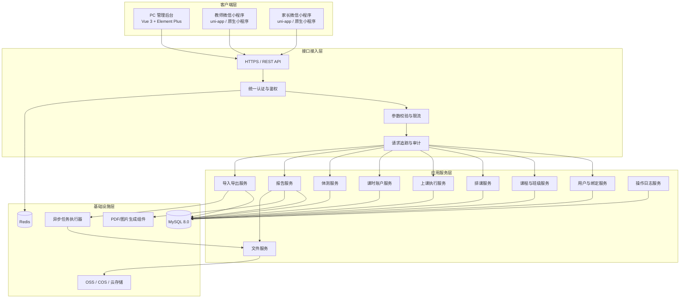
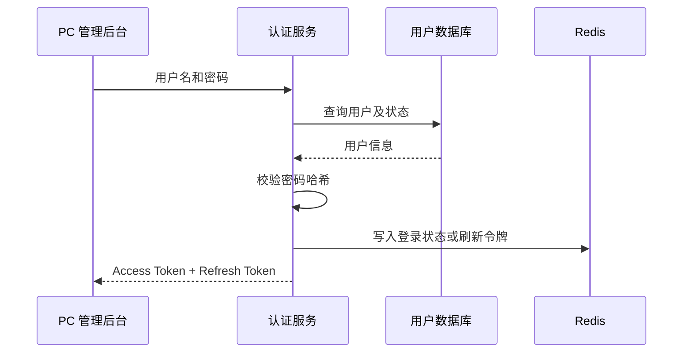
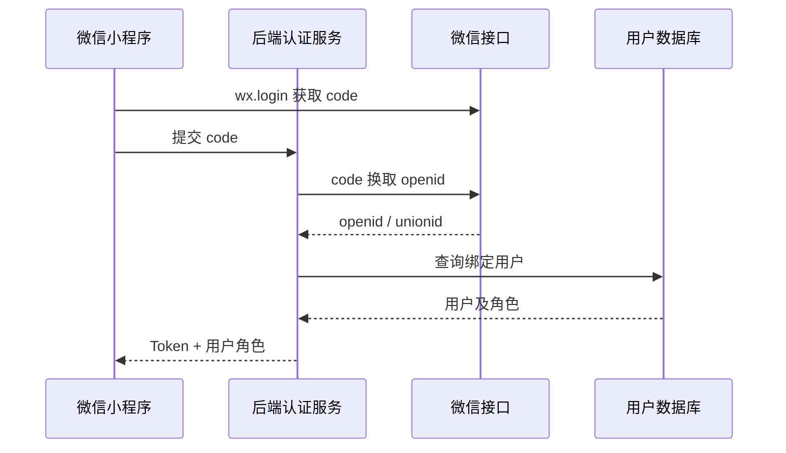
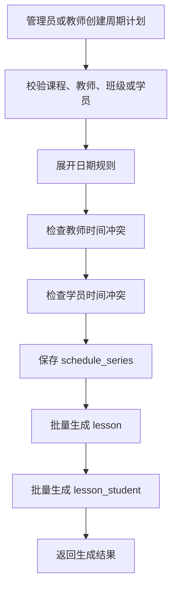
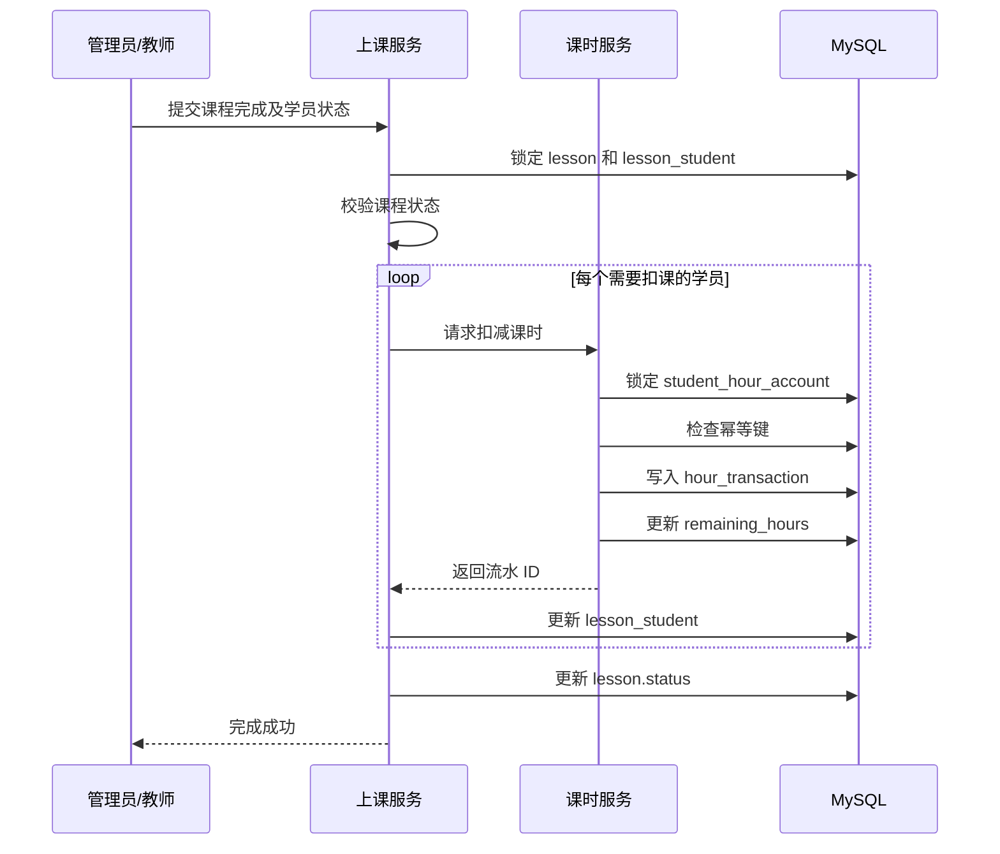
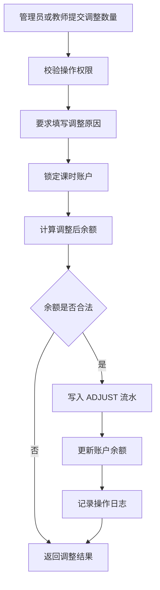
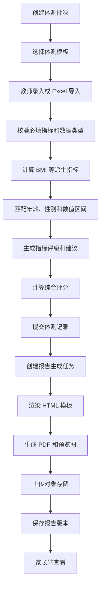
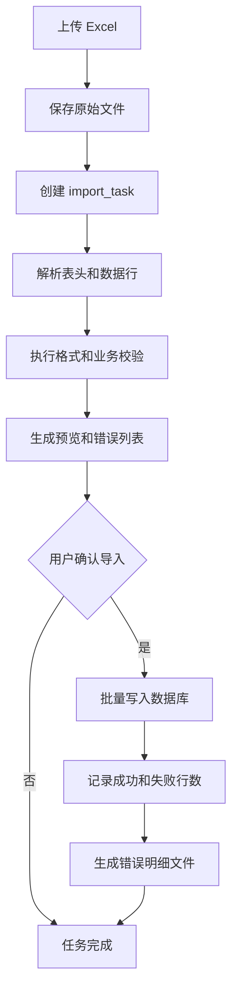
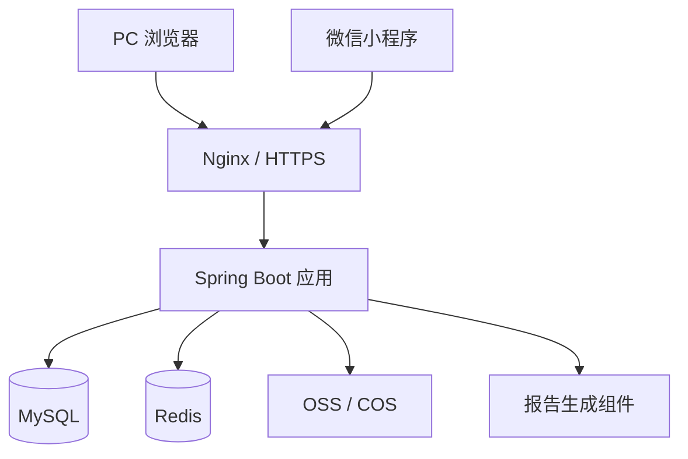

# 小程序排课与体测管理系统｜系统架构文档

## 1. 文档信息

| 项目 | 内容 |
|---|---|
| 系统名称 | 小程序排课与体测管理系统 |
| 文档类型 | 系统架构设计文档 |
| 目标版本 | V1.0 |
| 适用阶段 | 需求评审、技术设计、开发实施、测试验收 |
| 核心终端 | PC 管理后台、教师微信小程序、家长微信小程序 |
| 后端架构 | 单体模块化架构 |
| 数据库 | MySQL 8.0 |
| 文件存储 | 阿里云 OSS / 腾讯云 COS / 微信云存储 |
| 推荐技术栈 | Vue 3、uni-app、Spring Boot、MySQL、Redis |

---

# 2. 项目背景

本系统面向小型体育培训机构、儿童体适能机构及类似教培场景，用于统一管理：

- 学员、教师、家长账号；
- 课程和班级；
- 排课、调课和上课记录；
- 学员课时账户和课时流水；
- 体测模板、体测数据和体测报告；
- Excel 批量导入导出；
- 关键业务操作日志。

系统规模较小，第一版不建设多机构、多校区、多租户和复杂权限平台，优先保证业务流程完整、课时账目准确、体测数据可追溯。

---

# 3. 角色与终端设计

## 3.1 管理员

管理员主要通过 PC 管理后台操作。

管理员拥有：

- 学员、教师、家长账号管理；
- 家长与学员绑定；
- 课程和班级管理；
- 排课、调课和取消课程；
- 课程签到和完成；
- 课时充值、扣减、补录和调整；
- 体测模板和体测数据管理；
- 体测报告生成、重新生成和作废；
- Excel 导入导出；
- 全部操作日志查询。

## 3.2 教师

教师主要通过微信小程序操作。

教师与管理员在以下核心业务模块中的权限一致：

- 课程管理；
- 班级管理；
- 排课管理；
- 课时调整；
- 体测模板；
- 体测数据；
- 体测报告；
- Excel 导入导出。

教师不负责：

- 管理员账号管理；
- 全部教师账号管理；
- 全部家长账号管理；
- 查询其他用户的完整操作日志。

## 3.3 家长

家长通过微信小程序查看已绑定孩子的数据。

家长可以：

- 查看孩子课表；
- 查看课程签到和完成状态；
- 查看剩余课时；
- 查看课时流水；
- 查看历史上课记录；
- 查看体测报告；
- 保存报告图片或分享报告页面；
- 切换多个已绑定孩子。

家长不能修改课程、课时、体测和学员信息。

---

# 4. 建设原则

## 4.1 单体模块化优先

第一版采用单体模块化架构，而不是微服务架构。

原因：

1. 业务规模有限；
2. 开发团队规模较小；
3. 排课、课时和体测之间存在较强事务关联；
4. 单体架构部署和维护成本低；
5. 后续仍可按模块拆分服务。

模块之间通过应用服务和领域接口协作，不允许跨模块随意直接修改数据。

## 4.2 核心账务不可直接覆盖

课时余额属于关键业务资产。

系统禁止前端直接提交新的剩余课时值，所有变动必须通过课时流水完成：

```text
充值
消耗
退款
调整
撤销
历史导入
```

## 4.3 周期计划与实际课程分离

周期排课只描述重复规则，实际发生的每节课程必须单独生成课程实例。

```text
周期排课规则
    ↓
课程实例
    ↓
学员到课记录
    ↓
课时流水
```

## 4.4 数据权限由后端校验

前端隐藏菜单不是权限控制。

后端必须根据：

- 当前用户角色；
- 家长与学员绑定关系；
- 当前操作对象；
- 业务状态；

进行权限和状态校验。

## 4.5 历史数据不可被新配置污染

体测模板、评级标准和训练建议修改后，不应改变历史报告。

系统需要在体测记录中保存：

- 测试时年龄；
- 测试时性别；
- 指标评级；
- 分数；
- 建议文本；
- 报告版本。

---

# 5. 总体系统架构



---

# 6. 推荐技术选型

## 6.1 PC 管理后台

推荐：

```text
Vue 3
TypeScript
Vite
Element Plus
Pinia
Vue Router
Axios
```

主要承担：

- 账号管理；
- 学员和教师批量维护；
- 复杂排课；
- Excel 导入导出；
- 体测模板配置；
- 报表查询；
- 操作日志查询。

## 6.2 微信小程序

推荐：

```text
uni-app
Vue 3
TypeScript
Pinia
```

采用一个代码仓库，通过角色动态展示教师端和家长端页面。

第一版也可拆分为两个小程序，但会增加审核、发布和维护成本。

## 6.3 后端

推荐：

```text
Java 17+
Spring Boot 3
Spring Security
MyBatis-Plus / MyBatis
Hibernate Validator
JWT
Redis
MySQL 8.0
```

不建议第一版同时引入：

- Spring Cloud；
- Dubbo；
- Kafka；
- Elasticsearch；
- 分布式事务框架。

## 6.4 报告生成

推荐采用后端生成：

```text
HTML 模板
    ↓
填充体测数据
    ↓
生成 PDF
    ↓
生成报告预览图或长图
    ↓
上传对象存储
```

可选组件：

- OpenHTMLToPDF；
- Flying Saucer；
- iText；
- wkhtmltopdf；
- Playwright / Chromium 打印 PDF。

若报告版式偏网页化，推荐 Chromium 打印 PDF；若报告格式固定且重视性能，可使用 iText 或 OpenHTMLToPDF。

## 6.5 Excel 处理

推荐：

```text
EasyExcel
```

适用于：

- 学员导入；
- 排课计划导入；
- 历史课时导入；
- 体测数据导入；
- 业务报表导出。

---

# 7. 后端模块划分

建议使用按业务领域划分的包结构。

```text
com.example.training
├── auth
├── user
├── student
├── course
├── schedule
├── lesson
├── hour
├── physical
├── report
├── file
├── importexport
├── audit
├── notification
├── common
└── infrastructure
```

---

## 7.1 认证与权限模块 `auth`

职责：

- 管理员账号密码登录；
- 小程序微信登录；
- 手机号绑定；
- Token 签发和刷新；
- 用户状态校验；
- 角色鉴权；
- 家长学员关系校验；
- 登录失败限制。

核心对象：

```text
LoginService
TokenService
WechatLoginService
AuthorizationService
CurrentUser
```

---

## 7.2 用户模块 `user`

职责：

- 管理员账号管理；
- 教师账号管理；
- 家长账号管理；
- 教师资料维护；
- 家长资料维护；
- 用户启用、禁用和锁定。

---

## 7.3 学员模块 `student`

职责：

- 学员新增、修改和查询；
- 学员状态维护；
- 家长与学员绑定；
- 学员主要教师维护；
- 学员基本档案查询；
- 学员综合详情聚合。

---

## 7.4 课程模块 `course`

职责：

- 课程定义管理；
- 班级管理；
- 班级学员管理；
- 课程启用和停用；
- 默认时长和默认课时消耗配置。

---

## 7.5 排课模块 `schedule`

职责：

- 单次排课；
- 周期排课；
- 根据周期规则生成课程实例；
- 调课；
- 取消课程；
- 修改本次课程；
- 修改本次及以后课程；
- 教师时间冲突检查；
- 学员时间冲突检查。

---

## 7.6 上课执行模块 `lesson`

职责：

- 今日课程查询；
- 课程签到；
- 学员到课状态维护；
- 请假和缺勤登记；
- 完成课程；
- 撤销课程完成；
- 班级课逐学员确认；
- 联动课时扣减。

---

## 7.7 课时模块 `hour`

职责：

- 创建学员课时账户；
- 课时充值；
- 课程扣课；
- 手工调整；
- 课时退款；
- 撤销扣课；
- 历史课时导入；
- 课时余额查询；
- 课时流水查询；
- 幂等控制。

该模块是系统中事务要求最高的模块。

---

## 7.8 体测模块 `physical`

职责：

- 体测模板管理；
- 模板版本管理；
- 指标配置；
- 评级标准配置；
- 体测批次管理；
- 单个体测录入；
- Excel 批量导入；
- 派生指标计算；
- 指标评级；
- 综合评分；
- 历史体测查询。

---

## 7.9 报告模块 `report`

职责：

- 体测报告生成；
- PDF 生成；
- 图片生成；
- 报告版本管理；
- 报告作废；
- 家长报告授权访问；
- 报告重新生成；
- 报告文件生命周期管理。

---

## 7.10 文件模块 `file`

职责：

- 文件上传；
- 对象存储；
- 文件元数据保存；
- 文件访问权限控制；
- 临时下载地址生成；
- 文件类型和大小校验；
- 文件摘要计算。

---

## 7.11 导入导出模块 `importexport`

职责：

- Excel 文件上传；
- 模板下载；
- 文件解析；
- 数据预校验；
- 错误行生成；
- 用户确认导入；
- 批量写入；
- 导出任务生成；
- 导出文件下载。

---

## 7.12 审计模块 `audit`

职责：

- 记录关键业务操作；
- 保存变更前后数据；
- 保存操作用户和角色；
- 保存请求追踪 ID；
- 支持管理员查询全部日志；
- 支持教师查询本人日志。

---

# 8. 应用分层设计

每个业务模块内部建议采用以下分层：

```text
Controller
    ↓
Application Service
    ↓
Domain Service
    ↓
Repository
    ↓
MySQL / Redis / OSS
```

## 8.1 Controller 层

负责：

- 接收 HTTP 请求；
- 参数格式校验；
- 获取当前用户；
- 调用应用服务；
- 返回统一响应。

Controller 不应包含：

- 课时计算；
- 排课冲突算法；
- 体测评级逻辑；
- 数据库事务编排。

## 8.2 Application Service 层

负责：

- 业务用例编排；
- 开启事务；
- 调用多个领域服务；
- 权限校验；
- 幂等检查；
- 记录操作日志。

例如：

```text
CompleteLessonApplicationService
AdjustHourApplicationService
SubmitPhysicalRecordApplicationService
GenerateReportApplicationService
```

## 8.3 Domain Service 层

负责核心业务规则，例如：

- 判断课程能否完成；
- 计算应扣课时；
- 判断排课是否冲突；
- 匹配体测评级；
- 计算 BMI；
- 计算综合等级。

## 8.4 Repository 层

负责：

- 数据持久化；
- 行锁查询；
- 条件查询；
- 数据库对象与领域对象转换。

---

# 9. 核心业务流程

## 9.1 用户登录流程

### 管理员 PC 登录



### 教师或家长小程序登录



---

## 9.2 周期排课流程



周期计划修改必须支持：

- 仅修改本次；
- 修改本次及以后；
- 暂停整个计划；
- 结束整个计划。

---

## 9.3 完成课程并扣课时



必须保证：

- 一个学员在一节课中最多扣减一次；
- 余额不足时事务回滚；
- 重复请求不会重复扣课；
- 撤销完成时通过反向流水恢复课时。

---

## 9.4 手工调整课时



---

## 9.5 体测录入和报告生成



---

## 9.6 Excel 导入流程



导入操作不能在上传后立即写库，必须先预校验并确认。

---

# 10. 数据访问与权限架构

## 10.1 接口分组

### 管理员专属接口

```text
/api/admin/users/**
/api/admin/teachers/**
/api/admin/parents/**
/api/admin/audit-logs/**
```

### 管理员与教师共用接口

```text
/api/business/students/**
/api/business/courses/**
/api/business/classes/**
/api/business/schedules/**
/api/business/lessons/**
/api/business/hours/**
/api/business/physical/**
/api/business/reports/**
/api/business/imports/**
/api/business/exports/**
```

### 家长接口

```text
/api/parent/children/**
/api/parent/schedules/**
/api/parent/lessons/**
/api/parent/hours/**
/api/parent/reports/**
```

## 10.2 权限矩阵

| 模块 | 管理员 | 教师 | 家长 |
|---|---|---|---|
| 用户账号管理 | 全部 | 仅本人信息 | 仅本人信息 |
| 学员管理 | 全部 | 可管理 | 查看绑定孩子 |
| 课程管理 | 可管理 | 可管理 | 查看 |
| 班级管理 | 可管理 | 可管理 | 查看孩子班级 |
| 排课管理 | 可管理 | 可管理 | 查看孩子课表 |
| 课时调整 | 可操作 | 可操作 | 不可操作 |
| 课时流水 | 查看全部 | 查看业务数据 | 查看孩子流水 |
| 体测模板 | 可管理 | 可管理 | 不可操作 |
| 体测数据 | 可管理 | 可管理 | 查看孩子结果 |
| 体测报告 | 可管理 | 可管理 | 查看和保存 |
| Excel 导入导出 | 可操作 | 可操作 | 不可操作 |
| 操作日志 | 查看全部 | 查看本人 | 不可查看 |

## 10.3 家长数据权限

家长访问学员数据前必须校验：

```sql
EXISTS (
    SELECT 1
    FROM parent_student_relation
    WHERE parent_id = :currentParentId
      AND student_id = :targetStudentId
      AND bind_status = 'CONFIRMED'
)
```

---

# 11. API 设计规范

## 11.1 请求规范

统一使用：

```text
HTTPS
JSON
UTF-8
REST 风格
```

示例：

```http
POST /api/business/lessons/{lessonId}/complete
Authorization: Bearer <token>
Content-Type: application/json
```

```json
{
  "students": [
    {
      "studentId": 10001,
      "attendanceStatus": "PRESENT",
      "shouldConsume": true,
      "consumeHours": 1
    }
  ],
  "remark": "课程正常完成"
}
```

## 11.2 响应规范

```json
{
  "code": "SUCCESS",
  "message": "操作成功",
  "data": {},
  "requestId": "7e36c9a4f70b4c9d"
}
```

失败示例：

```json
{
  "code": "HOUR_BALANCE_NOT_ENOUGH",
  "message": "学员剩余课时不足",
  "data": {
    "studentId": 10001,
    "remainingHours": 0.5,
    "requiredHours": 1
  },
  "requestId": "7e36c9a4f70b4c9d"
}
```

## 11.3 分页规范

请求：

```text
pageNo
pageSize
```

响应：

```json
{
  "list": [],
  "pageNo": 1,
  "pageSize": 20,
  "total": 128
}
```

## 11.4 幂等规范

以下操作必须支持幂等：

- 完成课程；
- 扣减课时；
- 撤销扣课；
- 体测报告生成；
- Excel 正式导入。

可通过：

```text
Idempotency-Key
```

请求头或业务幂等键实现。

---

# 12. 错误码设计

| 错误码 | 说明 |
|---|---|
| UNAUTHORIZED | 未登录或 Token 无效 |
| FORBIDDEN | 无操作权限 |
| USER_DISABLED | 用户已禁用 |
| RESOURCE_NOT_FOUND | 资源不存在 |
| PARAMETER_INVALID | 请求参数错误 |
| DATA_CONFLICT | 数据状态冲突 |
| SCHEDULE_TEACHER_CONFLICT | 教师排课冲突 |
| SCHEDULE_STUDENT_CONFLICT | 学员排课冲突 |
| LESSON_ALREADY_COMPLETED | 课程已完成 |
| LESSON_ALREADY_CANCELLED | 课程已取消 |
| HOUR_BALANCE_NOT_ENOUGH | 剩余课时不足 |
| HOUR_TRANSACTION_DUPLICATE | 重复课时流水 |
| PHYSICAL_TEMPLATE_DISABLED | 体测模板不可用 |
| PHYSICAL_REQUIRED_ITEM_MISSING | 缺少必填体测指标 |
| REPORT_GENERATION_FAILED | 报告生成失败 |
| IMPORT_VALIDATION_FAILED | Excel 校验失败 |
| FILE_TYPE_NOT_ALLOWED | 文件类型不允许 |
| FILE_TOO_LARGE | 文件过大 |
| SYSTEM_ERROR | 系统内部错误 |

---

# 13. 缓存设计

Redis 第一版主要用于：

- 登录会话；
- Refresh Token；
- 登录失败计数；
- 短时间接口限流；
- 验证码；
- 临时导入状态；
- 短期报告访问令牌。

不建议将以下数据只保存在 Redis：

- 课时余额；
- 课时流水；
- 课程状态；
- 体测结果；
- 报告元数据。

这些数据必须以 MySQL 为准。

---

# 14. 异步任务设计

适合异步执行的任务：

- 批量 Excel 导入；
- Excel 导出；
- PDF 生成；
- 报告长图生成；
- 文件清理；
- 消息通知。

第一版可以使用：

```text
Spring TaskExecutor
数据库任务表
定时扫描
```

不必立即引入消息队列。

当任务量明显增加后，再考虑 RabbitMQ 或 Kafka。

## 14.1 任务状态

```text
PENDING
PROCESSING
SUCCESS
FAILED
```

异步任务需要记录：

- 创建人；
- 创建时间；
- 开始时间；
- 完成时间；
- 重试次数；
- 错误信息；
- 结果文件。

---

# 15. 文件存储架构

## 15.1 文件分类

```text
imports/
exports/
reports/pdf/
reports/image/
avatars/
templates/
errors/
```

## 15.2 文件安全

体测报告和导入文件可能包含个人信息，必须采用私有访问。

推荐：

```text
数据库保存 storage_key
    ↓
后端校验权限
    ↓
生成短期签名 URL
    ↓
客户端临时访问
```

不应在数据库中永久保存公开 URL。

## 15.3 文件限制

建议第一版限制：

| 类型 | 最大大小 |
|---|---:|
| Excel | 20 MB |
| 图片 | 10 MB |
| PDF | 30 MB |

上传时校验：

- 扩展名；
- MIME 类型；
- 文件头；
- 文件大小；
- 恶意公式或宏文件风险。

---

# 16. 安全设计

## 16.1 密码安全

管理员密码应使用：

```text
BCrypt
```

禁止：

- 明文密码；
- MD5；
- SHA1；
- 可逆加密保存密码。

## 16.2 Token 安全

建议：

```text
Access Token：短期有效
Refresh Token：较长期有效
```

Token 中只保存必要信息：

```text
userId
role
tokenVersion
expireAt
```

不要在 Token 中保存手机号、密码或敏感档案。

## 16.3 接口安全

必须实施：

- HTTPS；
- 参数校验；
- SQL 注入防护；
- 文件类型校验；
- 越权访问校验；
- 登录失败限制；
- 关键操作二次确认；
- 课时操作幂等；
- 报告访问鉴权。

## 16.4 敏感数据

以下数据属于敏感或重要个人信息：

- 手机号；
- 出生日期；
- 体测数据；
- 运动注意事项；
- 家长与孩子关系；
- 体测报告。

日志中应脱敏：

```text
138****1234
```

禁止在普通日志中打印：

- 登录密码；
- 微信 session_key；
- 完整 Token；
- 完整体测报告内容。

---

# 17. 日志与审计

## 17.1 系统日志

系统运行日志建议包含：

```text
requestId
userId
role
requestPath
HTTP method
耗时
响应状态
异常堆栈
```

## 17.2 业务审计日志

必须记录的关键操作：

- 新增和删除学员；
- 修改排课；
- 取消已完成课程；
- 手工调整课时；
- 撤销扣课；
- 修改体测数据；
- 重新生成或作废报告；
- Excel 导入；
- Excel 导出；
- 用户启用或禁用。

## 17.3 日志保留

建议：

- 应用运行日志保留 30～90 天；
- 操作日志长期保留；
- 课时流水永久保留；
- 报告版本按业务政策保留。

---

# 18. 数据一致性设计

## 18.1 数据库事务

以下操作必须使用事务：

- 完成课程并扣课；
- 撤销课程并退回课时；
- 手工调整课时；
- 批量生成课程实例；
- 提交体测记录；
- 正式导入课时数据。

## 18.2 行锁

课时操作应使用：

```sql
SELECT ...
FROM student_hour_account
WHERE student_id = ?
FOR UPDATE;
```

## 18.3 乐观锁

以下表建议增加 `version`：

- student_hour_account；
- lesson；
- physical_record；
- schedule_series。

更新时：

```sql
UPDATE student_hour_account
SET remaining_hours = ?,
    version = version + 1
WHERE id = ?
  AND version = ?;
```

## 18.4 数据库唯一约束

关键唯一约束：

```text
lesson_student(lesson_id, student_id)
hour_transaction(idempotency_key)
physical_record(batch_id, student_id)
physical_record_value(record_id, template_item_id)
physical_report(record_id, report_version)
parent_student_relation(parent_id, student_id)
```

---

# 19. 部署架构

## 19.1 V1 推荐部署



## 19.2 推荐服务器配置

初期可使用：

```text
2 核 CPU
4 GB 内存
50 GB 系统盘
MySQL 独立或托管数据库
Redis 小规格实例
对象存储
```

若报告生成使用 Chromium，建议后端服务器内存不少于 4 GB。

## 19.3 环境划分

至少保留：

```text
dev
test
prod
```

生产环境与测试环境必须使用独立：

- 数据库；
- Redis；
- 对象存储目录；
- 微信小程序配置；
- JWT 密钥。

---

# 20. 后端目录结构建议

```text
backend/
├── src/main/java/com/example/training/
│   ├── auth/
│   │   ├── controller/
│   │   ├── application/
│   │   ├── domain/
│   │   └── infrastructure/
│   ├── user/
│   ├── student/
│   ├── course/
│   ├── schedule/
│   ├── lesson/
│   ├── hour/
│   ├── physical/
│   ├── report/
│   ├── file/
│   ├── importexport/
│   ├── audit/
│   ├── common/
│   │   ├── api/
│   │   ├── exception/
│   │   ├── security/
│   │   ├── validation/
│   │   └── util/
│   └── infrastructure/
│       ├── persistence/
│       ├── redis/
│       ├── storage/
│       └── config/
├── src/main/resources/
│   ├── mapper/
│   ├── templates/
│   │   └── reports/
│   ├── db/
│   │   └── migration/
│   ├── application.yml
│   ├── application-dev.yml
│   ├── application-test.yml
│   └── application-prod.yml
└── pom.xml
```

---

# 21. 前端目录结构建议

## 21.1 PC 管理后台

```text
admin-web/
├── src/
│   ├── api/
│   ├── assets/
│   ├── components/
│   ├── layouts/
│   ├── router/
│   ├── stores/
│   ├── utils/
│   ├── views/
│   │   ├── login/
│   │   ├── dashboard/
│   │   ├── users/
│   │   ├── students/
│   │   ├── courses/
│   │   ├── schedules/
│   │   ├── lessons/
│   │   ├── hours/
│   │   ├── physical/
│   │   ├── reports/
│   │   ├── imports/
│   │   ├── exports/
│   │   └── audit/
│   └── main.ts
└── package.json
```

## 21.2 微信小程序

```text
miniapp/
├── src/
│   ├── api/
│   ├── components/
│   ├── pages/
│   │   ├── login/
│   │   ├── teacher/
│   │   │   ├── home/
│   │   │   ├── schedule/
│   │   │   ├── lesson/
│   │   │   ├── student/
│   │   │   ├── hour/
│   │   │   ├── physical/
│   │   │   └── report/
│   │   └── parent/
│   │       ├── home/
│   │       ├── schedule/
│   │       ├── hour/
│   │       ├── lesson/
│   │       └── report/
│   ├── stores/
│   ├── utils/
│   ├── static/
│   └── App.vue
└── package.json
```

---

# 22. 非功能性要求

## 22.1 性能目标

第一版建议目标：

| 指标 | 目标 |
|---|---|
| 普通查询接口 P95 | 小于 500 ms |
| 普通写入接口 P95 | 小于 800 ms |
| 周课表加载 | 小于 1 秒 |
| 课时扣减事务 | 小于 1 秒 |
| Excel 导入 | 异步执行 |
| 报告生成 | 异步执行 |
| 单次查询默认分页 | 20 条 |
| 单次最大分页 | 100 条 |

## 22.2 可用性

建议：

- 日常业务接口可用性目标 99.5%；
- MySQL 每日备份；
- 关键业务失败支持重试；
- 报告生成失败可重新执行；
- 导入失败不影响已存在数据。

## 22.3 可维护性

要求：

- 数据库变更使用 Flyway 或 Liquibase；
- 禁止手工修改生产数据库结构；
- 核心业务必须有单元测试；
- 课时模块必须有事务和并发测试；
- 所有异常返回统一错误码。

---

# 23. 数据备份与恢复

## 23.1 数据库备份

建议：

- 每日全量备份；
- 开启 binlog；
- 保留最近 7～30 天备份；
- 定期验证恢复流程。

## 23.2 文件备份

对象存储建议开启：

- 版本控制；
- 生命周期策略；
- 防误删除；
- 私有访问。

## 23.3 恢复优先级

恢复优先级：

```text
课时账户与流水
    ↓
排课与上课记录
    ↓
体测数据
    ↓
体测报告文件
    ↓
导入导出临时文件
```

---

# 24. 测试重点

## 24.1 课时模块

必须测试：

- 重复点击完成课程；
- 两名教师同时扣同一学员课时；
- 余额不足；
- 撤销扣课；
- 手工调整；
- 导入历史课时；
- 事务中途异常回滚。

## 24.2 排课模块

必须测试：

- 教师时间冲突；
- 学员时间冲突；
- 周期规则跨月；
- 修改本次；
- 修改本次及以后；
- 取消单次；
- 暂停周期计划。

## 24.3 体测模块

必须测试：

- 缺少必填指标；
- 数值格式错误；
- 年龄和性别标准匹配；
- 区间边界；
- BMI 自动计算；
- 历史标准不被新版本覆盖；
- 报告重复生成。

## 24.4 权限测试

必须测试：

- 家长访问未绑定学员；
- 教师访问管理员专属接口；
- 禁用用户继续访问；
- Token 过期；
- 报告临时地址越权访问。

---

# 25. V1 实施范围

## 25.1 必须实现

### PC 管理后台

- 管理员登录；
- 用户和学员管理；
- 课程和班级管理；
- 排课管理；
- 课时管理；
- 体测模板管理；
- 体测数据管理；
- 报告管理；
- Excel 导入导出；
- 操作日志。

### 教师小程序

- 微信登录；
- 课程和班级管理；
- 排课和调课；
- 今日课程；
- 签到和完成课程；
- 课时充值和调整；
- 学员查询；
- 体测录入；
- 报告生成和查看；
- Excel 导入导出。

### 家长小程序

- 微信登录；
- 手机号绑定；
- 多孩子切换；
- 查看课表；
- 查看课时；
- 查看上课记录；
- 查看体测报告。

## 25.2 暂不实现

- 多机构和多校区；
- 在线购买课程；
- 微信支付；
- 财务和发票；
- 教师工资结算；
- 教室资源排期；
- 智能排课；
- AI 自动训练建议；
- 销售线索；
- 审批工作流；
- 微服务拆分；
- 消息队列集群；
- 数据仓库和 BI 平台。

---

# 26. 后续扩展方向

## 26.1 课程套餐

当需要区分不同课程余额时，可增加：

```text
course_package
student_package
package_hour_transaction
```

## 26.2 多校区

当机构扩展后，可在核心表中增加：

```text
organization_id
campus_id
```

并引入数据隔离。

## 26.3 支付和订单

增加：

```text
order
order_item
payment_transaction
refund_transaction
```

## 26.4 消息通知

增加：

- 上课提醒；
- 课时不足提醒；
- 体测报告生成通知；
- 排课变更通知。

## 26.5 报表分析

增加：

- 教师课时统计；
- 学员出勤率；
- 班级利用率；
- 课时消耗趋势；
- 体测变化趋势；
- 续费提醒。

---

# 27. 架构决策总结

第一版系统采用：

```text
PC 管理后台 + 教师小程序 + 家长小程序
                ↓
        Spring Boot 单体模块化后端
                ↓
        MySQL + Redis + 对象存储
```

关键架构决策如下：

1. 管理员与教师共享核心业务权限；
2. 管理员额外承担账号和全局审计管理；
3. 家长只访问绑定学员数据；
4. 周期排课和课程实例分离；
5. 课程状态和学员到课状态分离；
6. 课时采用账户加流水模式；
7. 所有扣课操作必须幂等并使用事务；
8. 体测模板和指标采用动态结构；
9. 历史体测评级和建议保存快照；
10. 报告采用版本化管理；
11. Excel 导入采用预校验、确认、正式导入三阶段流程；
12. 第一版不引入微服务和复杂基础设施。

该架构能够满足当前小规模机构的实际业务，同时保留后续扩展为多校区、套餐、支付和数据分析系统的空间。
