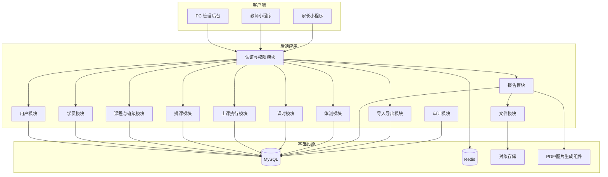
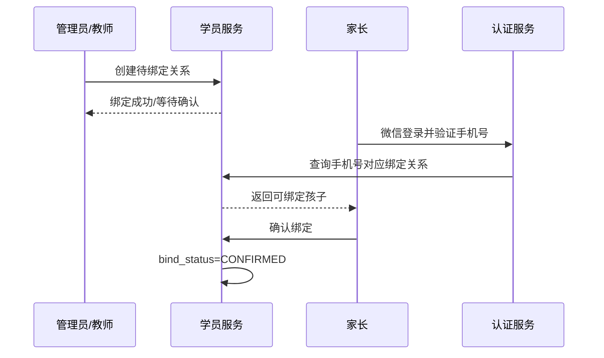
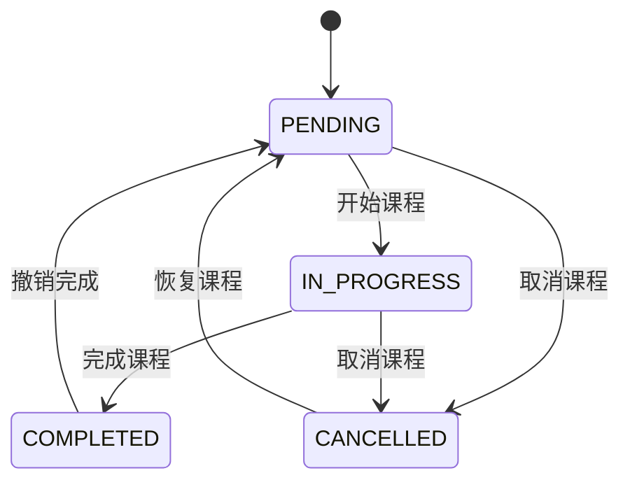
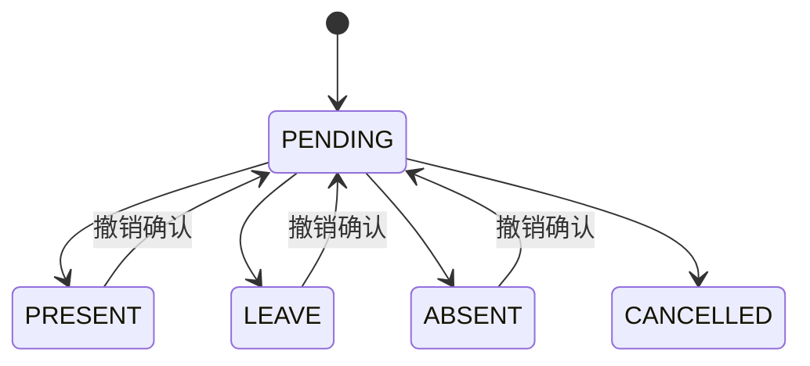
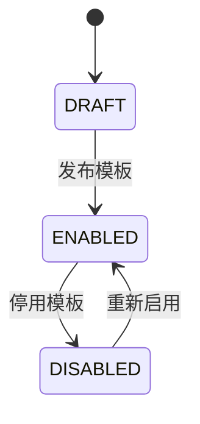
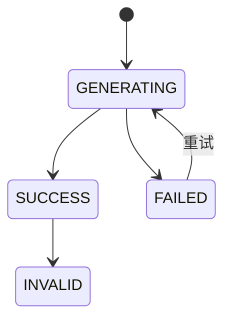
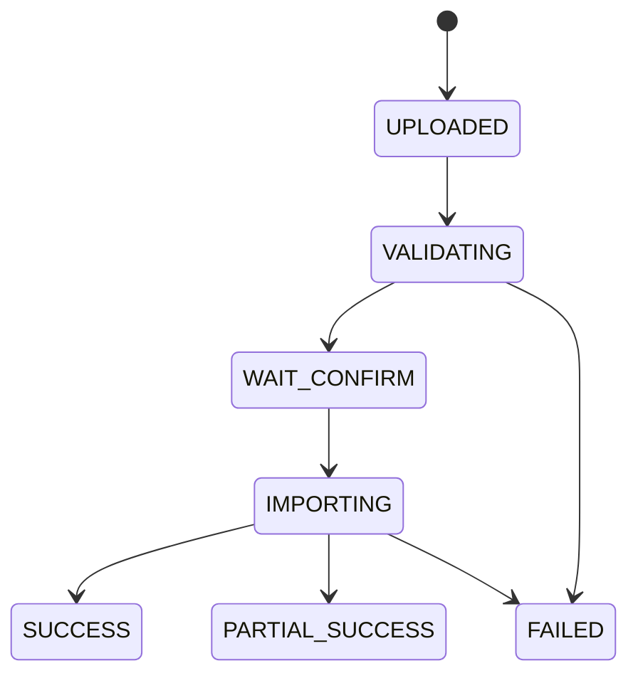
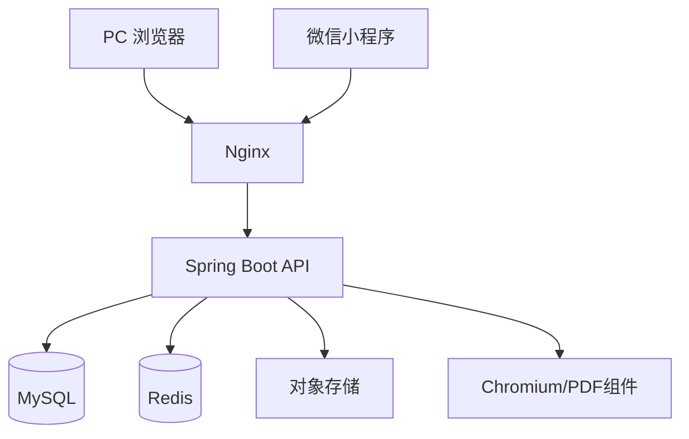

# 小程序排课与体测管理系统｜系统设计文档（SDD）

## 1. 文档信息

| 项目 | 内容 |
|---|---|
| 系统名称 | 小程序排课与体测管理系统 |
| 文档名称 | 系统设计文档（Software Design Description，SDD） |
| 文档版本 | V1.0 |
| 适用范围 | 详细设计、编码实现、联调测试、验收交付 |
| 关联文档 | 系统架构文档、数据库设计文档 |
| 推荐后端 | Java 17 + Spring Boot 3 |
| 推荐前端 | Vue 3 管理后台 + uni-app 微信小程序 |
| 数据库 | MySQL 8.0 |
| 缓存 | Redis |
| 文件存储 | 阿里云 OSS / 腾讯云 COS / 微信云存储 |

---

# 2. 文档目的

本文档用于将系统架构进一步细化为可直接指导研发实现的详细设计。

本文重点说明：

1. 系统模块边界；
2. 核心对象和职责；
3. 业务状态机；
4. 主要接口；
5. 数据表映射；
6. 关键事务；
7. 幂等与并发设计；
8. 异常处理；
9. 文件和报告生成；
10. Excel 导入导出；
11. 日志、审计和安全；
12. 单元测试与集成测试要求。

本文不重复完整数据库字段定义，具体字段以《数据库设计文档》为准。

---

# 3. 系统范围

## 3.1 角色

系统包含三个固定角色：

```text
ADMIN
TEACHER
PARENT
```

### 管理员

使用 PC 管理后台，拥有：

- 用户账号管理；
- 学员、课程、班级管理；
- 排课和调课；
- 课程签到和完成；
- 课时充值和调整；
- 体测模板、数据和报告管理；
- Excel 导入导出；
- 全部操作日志查询。

### 教师

使用微信小程序，与管理员共享以下业务权限：

- 课程管理；
- 班级管理；
- 排课管理；
- 课时调整；
- 体测模板；
- 体测数据；
- 体测报告；
- Excel 导入导出。

教师不具备管理员账号管理权限，也不能查询其他用户的完整操作日志。

### 家长

使用微信小程序，仅可访问已绑定学员的数据：

- 课表；
- 上课记录；
- 剩余课时；
- 课时流水；
- 体测记录；
- 体测报告。

---

## 3.2 V1 业务范围

V1 包含：

- 用户登录和身份认证；
- 学员、教师、家长资料；
- 家长和学员绑定；
- 课程和班级；
- 单次排课和周期排课；
- 签到、请假、缺勤和完成课程；
- 课时充值、扣减、调整和撤销；
- 体测模板和标准；
- 体测录入和评级；
- 报告生成和版本管理；
- Excel 导入导出；
- 操作日志；
- 文件管理。

V1 不包含：

- 多机构；
- 多校区；
- 在线支付；
- 财务管理；
- 教师工资；
- 课程销售；
- 智能排课；
- AI 训练建议；
- 审批流；
- 微服务拆分。

---

# 4. 设计约束

## 4.1 架构约束

采用单体模块化架构。

```text
Controller
    ↓
Application Service
    ↓
Domain Service
    ↓
Repository
    ↓
MySQL / Redis / OSS
```

禁止：

- Controller 直接操作 Mapper；
- 模块之间直接修改对方数据库表；
- 前端直接控制关键业务状态；
- 课时余额直接覆盖；
- 删除已生效的课时流水；
- 体测报告覆盖历史版本。

---

## 4.2 数据一致性约束

以下操作必须在数据库事务中完成：

- 完成课程并扣课时；
- 撤销课程并恢复课时；
- 手工调整课时；
- 批量生成课程实例；
- 提交体测记录；
- 正式导入课时数据；
- 正式导入排课数据。

---

## 4.3 权限约束

前端只负责界面展示，后端负责最终权限判断。

任何访问必须校验：

```text
当前用户身份
当前用户角色
目标数据是否存在
目标数据当前状态
当前角色是否允许执行操作
家长是否绑定目标学员
```

---

# 5. 总体模块设计



---

# 6. 项目代码组织

## 6.1 后端目录

```text
backend/
└── src/main/java/com/example/training/
    ├── auth/
    │   ├── controller/
    │   ├── application/
    │   ├── domain/
    │   ├── repository/
    │   └── infrastructure/
    ├── user/
    ├── student/
    ├── course/
    ├── schedule/
    ├── lesson/
    ├── hour/
    ├── physical/
    ├── report/
    ├── file/
    ├── importexport/
    ├── audit/
    ├── common/
    └── infrastructure/
```

---

## 6.2 每个模块建议结构

```text
module/
├── controller/
├── application/
│   ├── command/
│   ├── query/
│   ├── dto/
│   └── assembler/
├── domain/
│   ├── model/
│   ├── service/
│   ├── repository/
│   └── event/
├── infrastructure/
│   ├── persistence/
│   ├── mapper/
│   └── converter/
└── exception/
```

对于团队规模较小的项目，可以适当简化，但以下职责必须保持清晰：

- Controller：HTTP；
- Application Service：用例编排；
- Domain Service：业务规则；
- Repository：持久化；
- Mapper：SQL；
- DTO：接口对象；
- Entity/DO：数据库对象。

---

# 7. 通用设计

## 7.1 统一响应对象

```java
public record ApiResponse<T>(
        String code,
        String message,
        T data,
        String requestId
) {
    public static <T> ApiResponse<T> success(T data, String requestId) {
        return new ApiResponse<>("SUCCESS", "操作成功", data, requestId);
    }
}
```

---

## 7.2 分页对象

```java
public record PageRequest(
        Integer pageNo,
        Integer pageSize
) {
}
```

```java
public record PageResult<T>(
        List<T> list,
        long total,
        int pageNo,
        int pageSize
) {
}
```

约束：

```text
pageNo >= 1
1 <= pageSize <= 100
默认 pageSize = 20
```

---

## 7.3 当前用户对象

```java
public record CurrentUser(
        Long userId,
        String role,
        Long teacherId,
        Long parentId
) {
}
```

说明：

- 管理员只需要 `userId` 和 `role`；
- 教师需要 `teacherId`；
- 家长需要 `parentId`；
- 当前用户对象由认证过滤器解析后写入请求上下文。

---

## 7.4 统一异常体系

建议定义：

```text
BusinessException
ValidationException
AuthorizationException
ResourceNotFoundException
DataConflictException
SystemException
```

业务异常示例：

```java
throw new BusinessException(
        ErrorCode.HOUR_BALANCE_NOT_ENOUGH,
        "学员剩余课时不足"
);
```

---

## 7.5 错误码枚举

```java
public enum ErrorCode {
    UNAUTHORIZED,
    FORBIDDEN,
    USER_DISABLED,
    RESOURCE_NOT_FOUND,
    PARAMETER_INVALID,
    DATA_CONFLICT,
    SCHEDULE_TEACHER_CONFLICT,
    SCHEDULE_STUDENT_CONFLICT,
    LESSON_ALREADY_COMPLETED,
    LESSON_ALREADY_CANCELLED,
    HOUR_BALANCE_NOT_ENOUGH,
    HOUR_TRANSACTION_DUPLICATE,
    PHYSICAL_TEMPLATE_DISABLED,
    PHYSICAL_REQUIRED_ITEM_MISSING,
    REPORT_GENERATION_FAILED,
    IMPORT_VALIDATION_FAILED,
    FILE_TYPE_NOT_ALLOWED,
    FILE_TOO_LARGE,
    SYSTEM_ERROR
}
```

---

# 8. 认证与权限模块设计

## 8.1 模块职责

认证模块负责：

- 管理员账号密码登录；
- 微信小程序登录；
- Token 签发；
- Token 刷新；
- 用户状态校验；
- 角色鉴权；
- 家长和学员关系校验；
- 登录失败次数限制；
- 退出登录。

---

## 8.2 核心类

```text
AuthController
LoginApplicationService
WechatLoginApplicationService
TokenService
PasswordService
AuthorizationService
CurrentUserResolver
WechatClient
```

---

## 8.3 管理员登录接口

```http
POST /api/auth/admin/login
```

请求：

```json
{
  "username": "admin",
  "password": "******"
}
```

响应：

```json
{
  "accessToken": "xxx",
  "refreshToken": "xxx",
  "expiresIn": 7200,
  "role": "ADMIN"
}
```

处理流程：

```text
1. 查询 sys_user
2. 校验角色为 ADMIN
3. 校验用户状态
4. 校验 BCrypt 密码
5. 更新失败次数或登录时间
6. 签发 Token
7. 写入 Redis
8. 返回登录结果
```

---

## 8.4 小程序微信登录接口

```http
POST /api/auth/wechat/login
```

请求：

```json
{
  "code": "wx.login 返回的 code"
}
```

响应：

```json
{
  "accessToken": "xxx",
  "refreshToken": "xxx",
  "role": "TEACHER",
  "needBindPhone": false
}
```

处理流程：

```text
1. 调用微信接口换取 openid
2. 根据 openid 查询 sys_user
3. 若不存在，返回未绑定状态
4. 若存在，校验用户状态
5. 签发 Token
```

---

## 8.5 手机号绑定

```http
POST /api/auth/wechat/bind-phone
```

用于：

- 家长首次绑定；
- 教师首次绑定；
- 更换微信账号。

绑定成功后更新：

```text
sys_user.wechat_openid
sys_user.wechat_unionid
```

---

## 8.6 角色鉴权规则

```text
ADMIN：
可访问 /api/admin/**
可访问 /api/business/**

TEACHER：
可访问 /api/business/**
不可访问 /api/admin/**

PARENT：
仅可访问 /api/parent/**
```

---

## 8.7 家长数据授权接口

```java
public interface ParentStudentAuthorizationService {
    void checkBound(Long parentId, Long studentId);
}
```

校验条件：

```sql
parent_id = ?
student_id = ?
bind_status = 'CONFIRMED'
```

---

# 9. 用户模块设计

## 9.1 模块职责

用户模块负责：

- 管理员账号管理；
- 教师账号管理；
- 家长账号管理；
- 教师资料；
- 家长资料；
- 账号启用、禁用和锁定。

---

## 9.2 主要接口

### 创建教师账号

```http
POST /api/admin/teachers
```

请求：

```json
{
  "name": "张老师",
  "phone": "13800000000",
  "teacherNo": "T0001",
  "joinedDate": "2026-07-23"
}
```

处理：

```text
1. 校验管理员权限
2. 校验 teacherNo 唯一
3. 创建 sys_user
4. 创建 teacher_profile
5. 返回教师详情
```

---

### 禁用用户

```http
POST /api/admin/users/{userId}/disable
```

禁用后：

- 新 Token 不再签发；
- 已存在 Token 通过 `tokenVersion` 或 Redis 黑名单失效；
- 历史业务数据保留。

---

# 10. 学员模块设计

## 10.1 模块职责

- 新增学员；
- 修改学员；
- 查询学员；
- 学员状态管理；
- 家长绑定；
- 负责教师维护；
- 学员详情聚合。

---

## 10.2 核心对象

```text
Student
ParentStudentRelation
StudentDetailView
StudentSummaryView
```

---

## 10.3 新增学员接口

```http
POST /api/business/students
```

请求：

```json
{
  "studentNo": "S0001",
  "name": "张小明",
  "gender": "MALE",
  "birthDate": "2018-06-10",
  "primaryTeacherId": 1001,
  "enrollmentDate": "2026-07-01",
  "initialHours": 20,
  "parent": {
    "name": "张女士",
    "phone": "13800000000",
    "relationType": "MOTHER"
  }
}
```

处理事务：

```text
1. 创建 student
2. 创建 student_hour_account
3. 若 initialHours > 0，生成 RECHARGE 流水
4. 查找或创建家长账号
5. 创建 parent_student_relation
6. 记录操作日志
```

---

## 10.4 学员详情接口

```http
GET /api/business/students/{studentId}
```

返回：

```json
{
  "id": 10001,
  "studentNo": "S0001",
  "name": "张小明",
  "gender": "MALE",
  "age": 8,
  "remainingHours": 16,
  "primaryTeacher": {
    "id": 1001,
    "name": "李老师"
  },
  "parents": [],
  "currentClasses": [],
  "nextLesson": {},
  "latestPhysicalReport": {}
}
```

---

## 10.5 家长绑定流程



---

# 11. 课程与班级模块设计

## 11.1 模块职责

- 课程定义；
- 班级定义；
- 班级学员维护；
- 默认课时消耗；
- 默认上课时长；
- 课程启停。

---

## 11.2 课程对象

```java
public class Course {
    private Long id;
    private String courseCode;
    private String courseName;
    private CourseType courseType;
    private Integer defaultDurationMinutes;
    private BigDecimal defaultConsumeHours;
    private CourseStatus status;
}
```

---

## 11.3 新增课程接口

```http
POST /api/business/courses
```

请求：

```json
{
  "courseCode": "FIT_BASIC",
  "courseName": "儿童基础体能",
  "courseType": "SMALL_CLASS",
  "defaultDurationMinutes": 60,
  "defaultConsumeHours": 1,
  "description": "基础体适能训练"
}
```

---

## 11.4 班级管理接口

```http
POST /api/business/classes
PUT /api/business/classes/{classId}
POST /api/business/classes/{classId}/students
DELETE /api/business/classes/{classId}/students/{studentId}
GET /api/business/classes/{classId}
```

---

## 11.5 班级学员变更规则

学员退出班级时：

```text
不删除 class_group_student
更新 status = LEFT
记录 left_at
```

历史课程仍保留原有学员快照。

---

# 12. 排课模块设计

## 12.1 模块职责

- 单次排课；
- 周期排课；
- 课程实例生成；
- 教师冲突检查；
- 学员冲突检查；
- 修改本次；
- 修改本次及以后；
- 取消课程；
- 暂停和终止周期计划。

---

## 12.2 核心类

```text
ScheduleController
ScheduleApplicationService
ScheduleSeriesDomainService
LessonGenerationService
ScheduleConflictService
ScheduleRepository
LessonRepository
```

---

## 12.3 单次排课接口

```http
POST /api/business/schedules/single
```

请求：

```json
{
  "courseId": 2001,
  "teacherId": 1001,
  "classGroupId": 3001,
  "studentIds": [],
  "lessonDate": "2026-07-25",
  "startTime": "10:00",
  "endTime": "11:00",
  "consumeHours": 1,
  "location": "训练室A"
}
```

---

## 12.4 周期排课接口

```http
POST /api/business/schedules/series
```

请求：

```json
{
  "seriesName": "周六基础班",
  "courseId": 2001,
  "teacherId": 1001,
  "classGroupId": 3001,
  "recurrenceType": "WEEKLY",
  "weekdays": [6],
  "startDate": "2026-07-25",
  "endDate": "2026-10-31",
  "startTime": "10:00",
  "endTime": "11:00",
  "consumeHours": 1
}
```

---

## 12.5 周期实例生成算法

```text
输入：
开始日期
结束日期
星期列表
开始时间
结束时间

处理：
1. 从开始日期开始逐日扫描
2. 匹配 weekdays
3. 生成 lesson
4. 根据班级当前 ACTIVE 学员生成 lesson_student
5. 生成唯一 lesson_no
6. 批量插入
```

注意：

- 班级后续新增学员，不自动加入已经生成的历史课程；
- 是否加入未来课程由业务操作明确决定；
- 修改周期计划时不能直接覆盖已完成课程。

---

## 12.6 冲突检查

教师冲突条件：

```text
同一 teacher_id
同一 lesson_date
两个时间区间存在重叠
课程状态不是 CANCELLED
```

时间重叠判定：

```text
newStart < existingEnd
AND
newEnd > existingStart
```

学员冲突同理，通过 `lesson_student` 查询。

---

## 12.7 修改范围

```text
THIS_INSTANCE
THIS_AND_FOLLOWING
ENTIRE_SERIES
```

### THIS_INSTANCE

仅修改指定 lesson。

### THIS_AND_FOLLOWING

修改指定日期及其后未完成课程。

### ENTIRE_SERIES

修改整个周期规则，并重新计算所有未开始课程。

已完成课程不可被批量覆盖。

---

# 13. 上课执行模块设计

## 13.1 模块职责

- 今日课程；
- 学员签到；
- 请假；
- 缺勤；
- 课程完成；
- 课程撤销；
- 联动课时模块。

---

## 13.2 课程状态机



约束：

- `COMPLETED` 状态不可直接修改排课时间；
- 撤销完成时必须回滚课时；
- `CANCELLED` 状态不能完成。

---

## 13.3 学员到课状态机



---

## 13.4 签到接口

```http
POST /api/business/lessons/{lessonId}/students/{studentId}/sign-in
```

请求：

```json
{
  "attendanceStatus": "PRESENT",
  "remark": ""
}
```

---

## 13.5 完成课程接口

```http
POST /api/business/lessons/{lessonId}/complete
Idempotency-Key: LESSON_COMPLETE-10001
```

请求：

```json
{
  "students": [
    {
      "studentId": 10001,
      "attendanceStatus": "PRESENT",
      "shouldConsume": true,
      "consumeHours": 1
    },
    {
      "studentId": 10002,
      "attendanceStatus": "LEAVE",
      "shouldConsume": false,
      "consumeHours": 0
    }
  ],
  "remark": "课程正常完成"
}
```

---

## 13.6 完成课程事务

```text
BEGIN

1. SELECT lesson FOR UPDATE
2. 校验状态
3. 查询 lesson_student
4. 逐学员处理
5. 调用课时模块扣课
6. 更新 lesson_student
7. 更新 lesson.status = COMPLETED
8. 写操作日志

COMMIT
```

任何一个学员扣课失败时，整节课程默认回滚。

如果后续业务希望允许部分成功，需要增加独立确认机制，V1 不建议。

---

## 13.7 撤销完成接口

```http
POST /api/business/lessons/{lessonId}/rollback
```

处理：

```text
1. 锁定 lesson
2. 校验状态为 COMPLETED
3. 逐条查询 CONSUME 流水
4. 生成 ROLLBACK 流水
5. 恢复余额
6. 更新 lesson_student
7. lesson.status = PENDING
8. 记录日志
```

---

# 14. 课时模块设计

## 14.1 模块职责

- 课时账户；
- 充值；
- 消耗；
- 调整；
- 退款；
- 撤销；
- 导入；
- 流水查询；
- 幂等和并发控制。

---

## 14.2 核心类

```text
HourController
HourApplicationService
HourAccountDomainService
HourTransactionDomainService
HourRepository
HourTransactionRepository
```

---

## 14.3 账户对象

```java
public class StudentHourAccount {
    private Long id;
    private Long studentId;
    private BigDecimal totalRecharged;
    private BigDecimal totalConsumed;
    private BigDecimal totalRefunded;
    private BigDecimal remainingHours;
    private Integer version;
}
```

---

## 14.4 充值接口

```http
POST /api/business/students/{studentId}/hours/recharge
```

请求：

```json
{
  "amount": 20,
  "reason": "购买20课时"
}
```

处理：

```text
1. amount > 0
2. 锁定账户
3. 生成 RECHARGE 流水
4. 更新余额
5. 写操作日志
```

---

## 14.5 手工调整接口

```http
POST /api/business/students/{studentId}/hours/adjust
```

请求：

```json
{
  "changeAmount": -2,
  "reason": "修正历史课时"
}
```

禁止请求：

```json
{
  "targetBalance": 10
}
```

系统必须基于变化量计算新余额。

---

## 14.6 扣课方法

```java
public HourTransactionResult consume(
        Long studentId,
        Long lessonId,
        Long lessonStudentId,
        BigDecimal amount,
        String idempotencyKey,
        CurrentUser operator
)
```

---

## 14.7 幂等规则

消费幂等键：

```text
LESSON_CONSUME:{lessonStudentId}
```

撤销幂等键：

```text
LESSON_ROLLBACK:{lessonStudentId}
```

正式导入幂等键：

```text
IMPORT:{importTaskId}:{rowNo}
```

数据库必须对 `idempotency_key` 建唯一索引。

---

## 14.8 并发控制

使用悲观锁：

```sql
SELECT *
FROM student_hour_account
WHERE student_id = ?
FOR UPDATE;
```

同时使用唯一幂等键防止重复消费。

---

## 14.9 余额不足策略

V1 默认不允许负余额。

```text
afterBalance < 0
    ↓
抛出 HOUR_BALANCE_NOT_ENOUGH
    ↓
事务回滚
```

---

# 15. 体测模块设计

## 15.1 模块职责

- 体测模板；
- 模板指标；
- 评级标准；
- 体测批次；
- 体测记录；
- 自动计算；
- 评级；
- 综合评分；
- 数据快照。

---

## 15.2 核心类

```text
PhysicalTemplateController
PhysicalRecordController
PhysicalTemplateApplicationService
PhysicalRecordApplicationService
PhysicalCalculationService
PhysicalStandardMatchService
PhysicalScoreService
```

---

## 15.3 模板状态机



规则：

- `DRAFT` 可以编辑；
- `ENABLED` 且已产生记录后，不建议直接修改指标；
- 修改指标应复制生成新版本；
- 历史记录继续引用原版本。

---

## 15.4 指标类型

```text
NUMBER
TEXT
SELECT
CALCULATED
```

### NUMBER

例如：

- 身高；
- 体重；
- 50 米跑；
- 坐位体前屈。

### CALCULATED

例如：

- BMI；
- 综合得分。

---

## 15.5 体测记录提交接口

```http
POST /api/business/physical/records
```

请求：

```json
{
  "batchId": 5001,
  "studentId": 10001,
  "testDate": "2026-07-20",
  "values": [
    {
      "itemId": 6001,
      "value": 135
    },
    {
      "itemId": 6002,
      "value": 32
    },
    {
      "itemId": 6003,
      "value": 10.5
    }
  ]
}
```

---

## 15.6 提交流程

```text
1. 查询批次和模板
2. 校验批次状态
3. 校验模板状态
4. 校验学员
5. 校验必填指标
6. 校验数值格式
7. 计算派生指标
8. 匹配评级标准
9. 保存评级快照
10. 计算综合评分
11. 更新状态为 SUBMITTED
12. 写操作日志
```

---

## 15.7 BMI 计算

```text
BMI = 体重(kg) / 身高(m)^2
```

约束：

- 身高必须大于 0；
- 体重必须大于 0；
- 结果按模板配置保留小数位；
- 计算公式由后端白名单执行。

禁止使用 `eval` 或数据库动态 SQL 执行公式。

---

## 15.8 标准匹配

输入：

```text
template_item_id
gender_at_test
age_at_test
value
```

匹配条件：

```text
gender = 当前性别或 ALL
年龄在标准范围内
值在标准区间内
```

若多条规则同时匹配：

```text
priority 高者优先
性别精确匹配优先于 ALL
年龄范围更窄者优先
```

---

## 15.9 历史快照

体测记录必须保存：

```text
age_at_test
gender_at_test
level_code
level_name
score
suggestion
```

这样后续修改学员资料和评级标准不会改变历史结果。

---

# 16. 报告模块设计

## 16.1 模块职责

- 创建报告任务；
- 渲染 HTML；
- 生成 PDF；
- 生成预览图；
- 上传对象存储；
- 版本管理；
- 作废；
- 临时授权访问。

---

## 16.2 报告状态机



---

## 16.3 生成报告接口

```http
POST /api/business/physical/records/{recordId}/reports
Idempotency-Key: REPORT-10001
```

响应：

```json
{
  "reportId": 7001,
  "status": "GENERATING"
}
```

---

## 16.4 报告生成流程

```text
1. 校验体测记录状态
2. 查询最新报告版本
3. 生成新 report_version
4. 创建 GENERATING 记录
5. 组装报告视图模型
6. 渲染 HTML
7. 生成 PDF
8. 生成长图或预览图
9. 上传对象存储
10. 写 file_resource
11. 更新 report_status = SUCCESS
```

失败时：

```text
report_status = FAILED
generation_message = 错误摘要
```

---

## 16.5 报告视图模型

```java
public record PhysicalReportView(
        StudentInfoView student,
        PhysicalBatchView batch,
        List<PhysicalMetricView> metrics,
        BigDecimal overallScore,
        String overallLevel,
        String summary,
        List<String> suggestions
) {
}
```

---

## 16.6 报告版本规则

```text
同一个 record_id
report_version 从 1 递增
```

重新生成时：

- 不覆盖旧报告；
- 创建新版本；
- 家长端默认展示最新成功版本；
- 旧版本可由管理员或教师作废。

---

## 16.7 家长访问报告

```http
GET /api/parent/reports/{reportId}/access-url
```

后端处理：

```text
1. 根据 reportId 查询 studentId
2. 校验家长与学员绑定
3. 校验报告状态 SUCCESS
4. 生成短期签名 URL
5. 返回给小程序
```

---

# 17. 文件模块设计

## 17.1 模块职责

- 文件上传；
- 文件校验；
- 对象存储；
- 文件元数据；
- 临时访问地址；
- 文件删除；
- 文件生命周期。

---

## 17.2 上传流程

```text
1. 接收 MultipartFile
2. 校验大小
3. 校验扩展名
4. 校验 MIME
5. 校验文件头
6. 计算 SHA-256
7. 生成 storage_key
8. 上传对象存储
9. 保存 file_resource
```

---

## 17.3 存储路径规则

```text
imports/{yyyy}/{MM}/{uuid}.xlsx
exports/{yyyy}/{MM}/{uuid}.xlsx
reports/pdf/{yyyy}/{MM}/{uuid}.pdf
reports/image/{yyyy}/{MM}/{uuid}.png
avatars/{yyyy}/{MM}/{uuid}.jpg
errors/{yyyy}/{MM}/{uuid}.xlsx
```

---

## 17.4 文件访问级别

```text
PRIVATE
AUTHORIZED
PUBLIC
```

默认：

- Excel：PRIVATE；
- 体测报告：AUTHORIZED；
- 头像：AUTHORIZED 或 PUBLIC；
- 导出文件：PRIVATE。

---

# 18. Excel 导入模块设计

## 18.1 模块职责

- 下载模板；
- 上传文件；
- 解析；
- 字段映射；
- 预校验；
- 错误预览；
- 确认导入；
- 批量写库；
- 错误文件生成。

---

## 18.2 导入类型

```text
STUDENT
COURSE
CLASS_STUDENT
SCHEDULE
HOUR
PHYSICAL_TEST
```

---

## 18.3 导入状态机



---

## 18.4 导入接口

### 上传并校验

```http
POST /api/business/imports
Content-Type: multipart/form-data
```

参数：

```text
importType
file
```

### 查询校验结果

```http
GET /api/business/imports/{taskId}
```

### 确认导入

```http
POST /api/business/imports/{taskId}/confirm
Idempotency-Key: IMPORT-10001
```

---

## 18.5 预校验规则

通用校验：

- 表头是否正确；
- 必填列是否存在；
- 数据类型是否正确；
- 枚举是否有效；
- 日期格式是否正确；
- 编号是否重复；
- 关联实体是否存在。

业务校验示例：

### 学员导入

- student_no 唯一；
- 姓名非空；
- 出生日期合法；
- 教师编号存在；
- 初始课时非负。

### 排课导入

- 教师存在；
- 课程存在；
- 学员或班级存在；
- 时间合法；
- 不存在冲突。

### 体测导入

- 学员唯一标识有效；
- 模板指标存在；
- 必填项完整；
- 数值范围合理。

---

## 18.6 错误明细格式

```text
行号
字段
原始值
错误码
错误说明
```

示例：

```text
第 5 行
字段：家长手机号
原始值：138000
错误：手机号格式错误
```

---

## 18.7 正式导入策略

V1 建议：

- 一次导入任务整体事务；
- 存在错误行时不自动导入；
- 用户修正后重新上传。

如果需要部分成功：

- 每 200～500 行一个事务批次；
- 记录成功和失败行；
- 生成错误文件。

---

# 19. Excel 导出模块设计

## 19.1 导出类型

```text
STUDENT
SCHEDULE
LESSON
HOUR
PHYSICAL_TEST
REPORT
```

---

## 19.2 导出流程

```text
1. 接收导出条件
2. 创建 export_task
3. 异步查询数据
4. 生成 Excel
5. 上传对象存储
6. 更新任务状态
7. 返回临时下载地址
```

---

## 19.3 导出接口

```http
POST /api/business/exports
```

请求：

```json
{
  "exportType": "HOUR",
  "conditions": {
    "studentId": 10001,
    "startDate": "2026-07-01",
    "endDate": "2026-07-31"
  }
}
```

---

# 20. 操作日志模块设计

## 20.1 必须记录的操作

```text
创建、修改、删除学员
创建、修改、取消排课
完成课程
撤销完成
课时充值
课时调整
体测数据修改
报告生成
报告作废
Excel 导入
Excel 导出
用户启用和禁用
```

---

## 20.2 日志切面

建议通过注解和 AOP 记录：

```java
@OperationAudit(
    module = "HOUR",
    action = "ADJUST",
    targetType = "STUDENT_HOUR_ACCOUNT"
)
```

---

## 20.3 日志字段

```text
operator_id
operator_role
module
action
target_type
target_id
before_data
after_data
request_id
operation_result
error_message
created_at
```

敏感字段必须脱敏。

---

# 21. 通知设计

V1 可先只设计接口，不强制完整实现。

可能的通知事件：

- 课程新增；
- 课程调课；
- 课程取消；
- 课时不足；
- 体测报告生成完成。

推荐抽象：

```java
public interface NotificationService {
    void send(NotificationCommand command);
}
```

V1 可先使用：

- 小程序订阅消息；
- 站内消息；
- 不发送，仅保留事件接口。

---

# 22. 数据库表与模块映射

| 模块 | 主要数据表 |
|---|---|
| 认证与用户 | sys_user、teacher_profile、parent_profile |
| 学员 | student、parent_student_relation |
| 课程与班级 | course、class_group、class_group_student |
| 排课 | schedule_series、lesson、lesson_student |
| 课时 | student_hour_account、hour_transaction |
| 体测 | physical_template、physical_template_item、physical_standard、physical_batch、physical_record、physical_record_value |
| 报告 | physical_report、file_resource |
| 文件 | file_resource |
| 导入导出 | import_task、export_task、file_resource |
| 审计 | operation_log |

---

# 23. 主要接口清单

## 23.1 认证

```text
POST /api/auth/admin/login
POST /api/auth/wechat/login
POST /api/auth/wechat/bind-phone
POST /api/auth/refresh
POST /api/auth/logout
GET  /api/auth/me
```

## 23.2 用户

```text
POST /api/admin/teachers
PUT  /api/admin/teachers/{id}
GET  /api/admin/teachers
POST /api/admin/users/{id}/enable
POST /api/admin/users/{id}/disable
GET  /api/admin/parents
```

## 23.3 学员

```text
POST /api/business/students
PUT  /api/business/students/{id}
GET  /api/business/students
GET  /api/business/students/{id}
POST /api/business/students/{id}/bind-parent
```

## 23.4 课程与班级

```text
POST /api/business/courses
PUT  /api/business/courses/{id}
GET  /api/business/courses
POST /api/business/classes
PUT  /api/business/classes/{id}
POST /api/business/classes/{id}/students
DELETE /api/business/classes/{id}/students/{studentId}
```

## 23.5 排课

```text
POST /api/business/schedules/single
POST /api/business/schedules/series
PUT  /api/business/lessons/{id}
POST /api/business/lessons/{id}/cancel
POST /api/business/schedule-series/{id}/pause
POST /api/business/schedule-series/{id}/resume
GET  /api/business/schedules/week
```

## 23.6 上课

```text
POST /api/business/lessons/{id}/start
POST /api/business/lessons/{id}/students/{studentId}/sign-in
POST /api/business/lessons/{id}/complete
POST /api/business/lessons/{id}/rollback
GET  /api/business/lessons/today
```

## 23.7 课时

```text
GET  /api/business/students/{id}/hours
GET  /api/business/students/{id}/hour-transactions
POST /api/business/students/{id}/hours/recharge
POST /api/business/students/{id}/hours/adjust
POST /api/business/students/{id}/hours/refund
```

## 23.8 体测

```text
POST /api/business/physical/templates
PUT  /api/business/physical/templates/{id}
POST /api/business/physical/templates/{id}/enable
POST /api/business/physical/batches
POST /api/business/physical/records
PUT  /api/business/physical/records/{id}
GET  /api/business/physical/students/{studentId}/records
```

## 23.9 报告

```text
POST /api/business/physical/records/{recordId}/reports
POST /api/business/reports/{reportId}/retry
POST /api/business/reports/{reportId}/invalidate
GET  /api/business/reports/{reportId}
GET  /api/parent/reports/{reportId}/access-url
```

## 23.10 导入导出

```text
POST /api/business/imports
GET  /api/business/imports/{id}
POST /api/business/imports/{id}/confirm
POST /api/business/exports
GET  /api/business/exports/{id}
```

---

# 24. 家长端接口设计

## 24.1 查询绑定孩子

```http
GET /api/parent/children
```

## 24.2 查询孩子课表

```http
GET /api/parent/children/{studentId}/schedules
```

参数：

```text
startDate
endDate
```

## 24.3 查询剩余课时

```http
GET /api/parent/children/{studentId}/hours
```

## 24.4 查询课时流水

```http
GET /api/parent/children/{studentId}/hour-transactions
```

## 24.5 查询体测报告

```http
GET /api/parent/children/{studentId}/reports
```

每个接口都必须执行家长绑定校验。

---

# 25. 事务边界设计

## 25.1 创建学员

事务范围：

```text
student
student_hour_account
初始 hour_transaction
parent_student_relation
operation_log
```

---

## 25.2 完成课程

事务范围：

```text
lesson
lesson_student
student_hour_account
hour_transaction
operation_log
```

---

## 25.3 撤销完成

事务范围：

```text
lesson
lesson_student
student_hour_account
hour_transaction
operation_log
```

---

## 25.4 提交体测记录

事务范围：

```text
physical_record
physical_record_value
operation_log
```

报告生成不放在同一个事务中。

---

## 25.5 正式导入

正式导入需要根据类型建立独立事务服务：

```text
StudentImportApplicationService
ScheduleImportApplicationService
HourImportApplicationService
PhysicalImportApplicationService
```

---

# 26. 异步任务设计

## 26.1 适合异步任务

```text
报告 PDF 生成
报告图片生成
Excel 导入解析
Excel 导出
错误文件生成
历史文件清理
通知发送
```

---

## 26.2 V1 实现方案

采用：

```text
Spring TaskExecutor
数据库任务表
定时任务补偿
```

处理逻辑：

```text
1. 业务请求创建任务记录
2. 提交线程池
3. 任务执行
4. 更新状态
5. 失败记录错误
6. 定时扫描超时任务
```

---

## 26.3 任务重试

建议：

```text
最大重试次数：3
重试间隔：1 分钟、5 分钟、15 分钟
```

报告和导出任务可重试。

正式课时扣减不通过异步重试。

---

# 27. 缓存设计

Redis 使用场景：

```text
登录会话
Refresh Token
验证码
登录失败计数
接口限流
短期幂等结果
报告临时访问令牌
任务进度
```

MySQL 为以下数据的唯一事实来源：

```text
课时账户
课时流水
课程状态
学员到课状态
体测记录
报告元数据
```

---

# 28. 安全设计

## 28.1 身份认证

- 管理员使用账号密码；
- 教师和家长使用微信登录；
- 管理员密码使用 BCrypt；
- Access Token 短期有效；
- Refresh Token 存 Redis；
- 禁用用户立即失效。

---

## 28.2 接口安全

必须：

- HTTPS；
- Token 校验；
- 角色校验；
- 数据权限校验；
- 参数校验；
- 幂等校验；
- 文件校验；
- 请求限流；
- 日志脱敏。

---

## 28.3 敏感数据

敏感数据包括：

```text
手机号
出生日期
体测数据
运动注意事项
家长学员关系
体测报告
```

接口返回遵循最小必要原则。

---

# 29. 日志设计

## 29.1 请求日志

记录：

```text
requestId
userId
role
method
path
status
duration
clientIp
```

---

## 29.2 异常日志

记录：

```text
requestId
异常类型
错误码
错误摘要
堆栈
关键业务 ID
```

禁止记录：

```text
密码
完整 Token
微信 session_key
完整手机号
体测报告全文
```

---

# 30. 性能设计

## 30.1 查询分页

所有列表接口必须分页。

默认：

```text
pageSize = 20
最大 pageSize = 100
```

---

## 30.2 批量操作

批量插入建议：

```text
每批 200～500 条
```

避免一次插入过多。

---

## 30.3 索引使用

高频查询：

- 教师周课表；
- 家长孩子课表；
- 学员课时流水；
- 学员历史体测；
- 报告列表；
- 导入任务状态。

---

## 30.4 报告生成

报告生成采用异步方式，避免阻塞接口线程。

---

# 31. 前端页面与接口映射

## 31.1 PC 管理后台

| 页面 | 主要接口 |
|---|---|
| 登录 | /api/auth/admin/login |
| 教师管理 | /api/admin/teachers |
| 家长管理 | /api/admin/parents |
| 学员管理 | /api/business/students |
| 课程管理 | /api/business/courses |
| 班级管理 | /api/business/classes |
| 排课管理 | /api/business/schedules/** |
| 课时管理 | /api/business/students/{id}/hours/** |
| 体测模板 | /api/business/physical/templates |
| 体测数据 | /api/business/physical/records |
| 报告管理 | /api/business/reports |
| 导入导出 | /api/business/imports、/exports |
| 操作日志 | /api/admin/audit-logs |

---

## 31.2 教师小程序

| 页面 | 主要接口 |
|---|---|
| 首页 | 今日课程、待处理事项 |
| 课表 | 周课表接口 |
| 上课详情 | lesson 详情、签到、完成 |
| 学员列表 | students |
| 课时调整 | hours/recharge、hours/adjust |
| 体测录入 | physical/records |
| 报告列表 | reports |
| Excel 导入 | imports |

---

## 31.3 家长小程序

| 页面 | 主要接口 |
|---|---|
| 首页 | children、下一节课、剩余课时 |
| 课表 | children/{id}/schedules |
| 课时 | children/{id}/hours |
| 课时明细 | children/{id}/hour-transactions |
| 上课记录 | children/{id}/lessons |
| 体测报告 | children/{id}/reports |

---

# 32. 核心测试设计

## 32.1 课时模块

必须覆盖：

```text
重复完成课程
并发扣同一学员课时
余额不足
扣减 0.5 课时
手工调整
撤销扣课
重复撤销
导入历史课时
事务回滚
```

---

## 32.2 排课模块

必须覆盖：

```text
教师冲突
学员冲突
跨月周期
修改本次
修改本次及以后
取消单次
暂停周期
恢复周期
已完成课程不可批量修改
```

---

## 32.3 体测模块

必须覆盖：

```text
缺少必填指标
非法数值
BMI 计算
年龄边界
性别匹配
标准区间边界
无匹配标准
模板版本
历史快照
报告重复生成
```

---

## 32.4 权限模块

必须覆盖：

```text
教师访问管理员接口
家长访问未绑定学员
禁用用户访问
Token 过期
Token 伪造
报告越权
导出越权
操作日志越权
```

---

# 33. 集成测试场景

## 场景一：新学员完整建档

```text
创建学员
创建课时账户
充值课时
绑定家长
家长登录
查看孩子
```

---

## 场景二：周期排课到课时扣减

```text
创建课程
创建班级
加入学员
创建周期排课
生成 lesson
教师签到
完成课程
扣减课时
家长查看记录
```

---

## 场景三：体测报告

```text
创建模板
创建指标
配置标准
创建批次
录入数据
自动评级
生成报告
家长查看
重新生成版本
```

---

## 场景四：Excel 导入

```text
上传 Excel
预校验
展示错误
修正文件
重新上传
确认导入
查询结果
```

---

# 34. 部署设计

## 34.1 服务组成

```text
admin-web
miniapp
backend-api
mysql
redis
object-storage
report-renderer
```

---

## 34.2 推荐部署



---

## 34.3 环境

```text
dev
test
prod
```

环境之间必须隔离：

```text
数据库
Redis
对象存储目录
JWT 密钥
微信配置
日志目录
```

---

# 35. 配置项设计

建议配置：

```yaml
app:
  jwt:
    access-token-expire-seconds: 7200
    refresh-token-expire-seconds: 2592000

  file:
    max-excel-size-mb: 20
    max-image-size-mb: 10
    max-pdf-size-mb: 30

  hour:
    allow-negative-balance: false

  report:
    max-retry-count: 3
    renderer: chromium

  import:
    batch-size: 300
    max-rows: 10000
```

---

# 36. 数据迁移设计

使用 Flyway 或 Liquibase。

建议目录：

```text
src/main/resources/db/migration/
├── V1__init_user_tables.sql
├── V2__init_student_tables.sql
├── V3__init_course_schedule_tables.sql
├── V4__init_hour_tables.sql
├── V5__init_physical_tables.sql
├── V6__init_file_task_tables.sql
└── V7__init_audit_tables.sql
```

禁止：

- 手工修改生产表结构；
- 覆盖已执行迁移；
- 删除历史迁移脚本。

---

# 37. 代码质量要求

## 37.1 必须项

- 所有接口参数使用 Bean Validation；
- 所有数据库写操作有明确事务边界；
- 课时模块必须有并发测试；
- 核心枚举统一定义；
- 错误码统一；
- 不使用魔法字符串；
- 操作日志统一；
- 敏感字段脱敏；
- Mapper SQL 可审计。

---

## 37.2 推荐项

- 使用 MapStruct 进行对象转换；
- 使用 OpenAPI 生成接口文档；
- 使用 Testcontainers 做数据库集成测试；
- 使用 Jacoco 统计覆盖率；
- 使用 Checkstyle 或 Spotless 统一代码风格。

---

# 38. 验收标准

## 38.1 功能验收

系统能够完成：

- 三类角色登录；
- 学员和家长绑定；
- 单次和周期排课；
- 课程签到和完成；
- 自动扣课；
- 手工调课时；
- 体测模板和录入；
- 体测报告生成；
- Excel 导入导出；
- 家长查看；
- 操作日志。

---

## 38.2 数据验收

必须满足：

- 重复完成课程不重复扣课；
- 课时余额与流水可核对；
- 已完成课程可追溯；
- 历史体测结果不受新标准影响；
- 报告版本不覆盖；
- 家长不能访问未绑定孩子；
- 删除业务数据不破坏历史链路。

---

## 38.3 性能验收

建议：

| 指标 | 目标 |
|---|---|
| 普通查询接口 P95 | < 500 ms |
| 普通写入接口 P95 | < 800 ms |
| 课时扣减事务 | < 1 s |
| 周课表加载 | < 1 s |
| 报告生成 | 异步完成 |
| Excel 导入 | 异步完成 |

---

# 39. 关键设计决策

1. 使用单体模块化架构，不使用微服务；
2. 管理员和教师共享核心业务权限；
3. 家长通过绑定关系访问学员；
4. 周期排课规则与实际课程分离；
5. 课程状态与学员到课状态分离；
6. 课时采用账户加流水模式；
7. 课时操作使用事务、行锁和幂等键；
8. 体测指标采用动态结构；
9. 体测评级保存历史快照；
10. 报告采用异步生成和版本管理；
11. Excel 导入采用预校验、确认、正式导入；
12. 对象存储采用私有访问和临时授权；
13. 关键业务操作必须审计；
14. MySQL 是核心业务数据唯一事实来源。

---

# 40. 后续扩展预留

未来可增加：

```text
多机构
多校区
课程套餐
订单
微信支付
退款
教师工资
教室资源
消息通知
续费提醒
数据分析
AI 训练建议
```

扩展时建议优先增加：

```text
organization_id
campus_id
course_package
student_package
order
payment_transaction
```

但 V1 不提前引入这些复杂结构。

---

# 41. 结论

本 SDD 将系统架构细化为可实施的软件设计，明确了：

- 模块职责；
- 接口边界；
- 状态机；
- 数据关系；
- 事务范围；
- 权限规则；
- 幂等与并发控制；
- 文件和报告流程；
- 测试和验收标准。

研发实施时，应优先保证以下三条主链路稳定：

```text
排课 → 上课 → 课时扣减
```

```text
体测模板 → 体测录入 → 报告生成
```

```text
家长绑定 → 数据授权 → 家长查看
```

其中，课时流水和体测历史数据属于系统最重要的可追溯业务数据，任何实现都不得绕过事务、幂等和审计机制。
